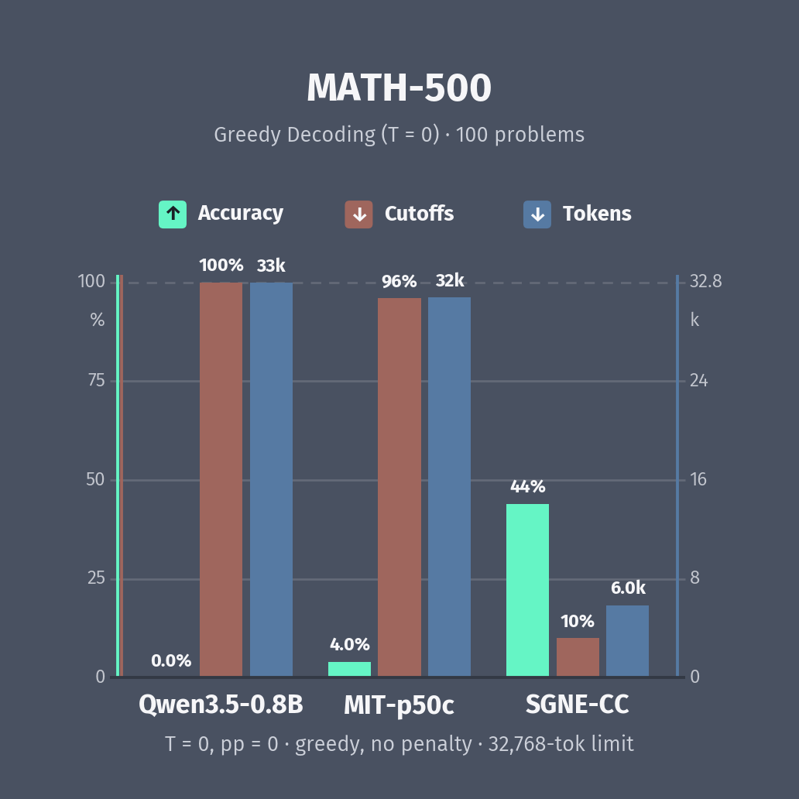
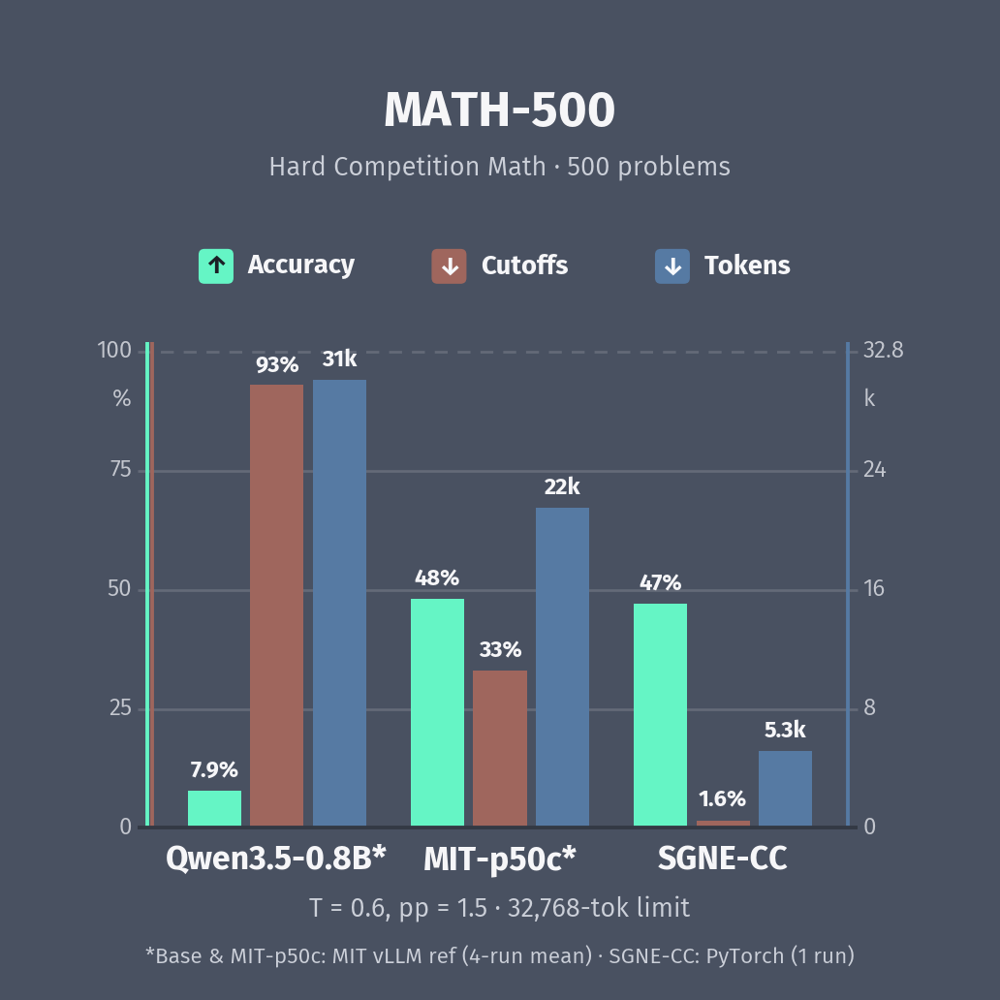
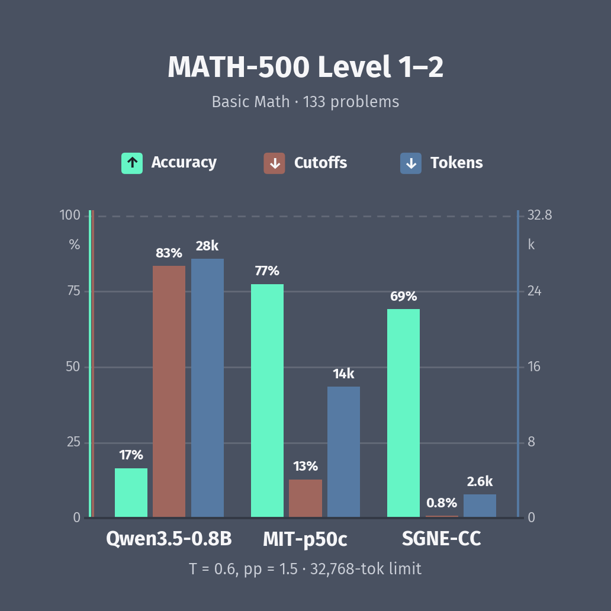
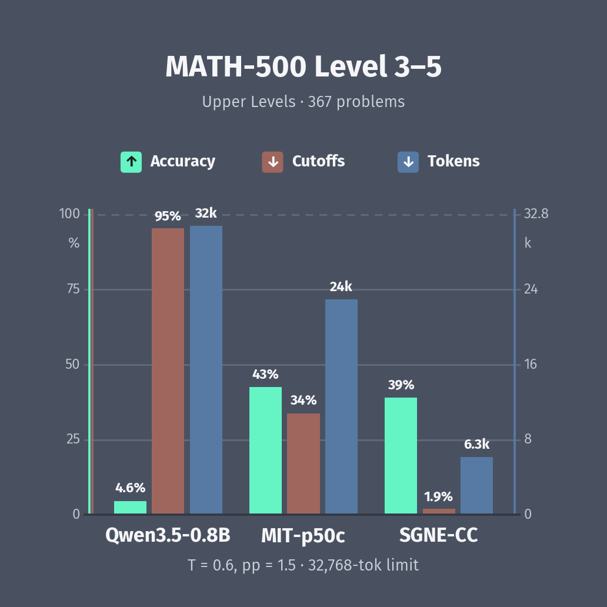
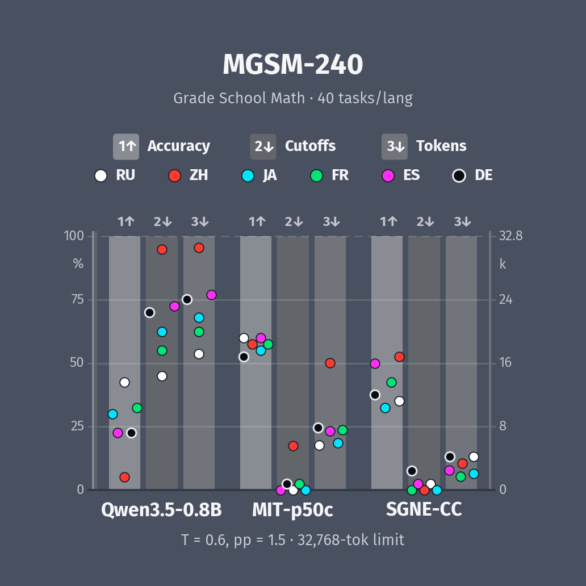
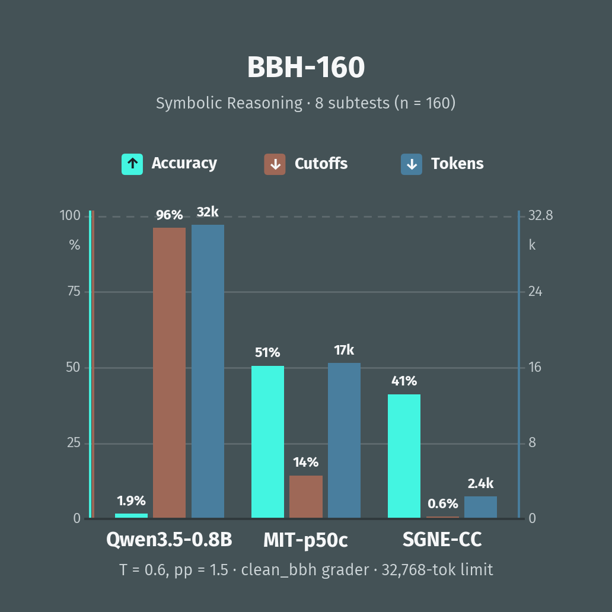
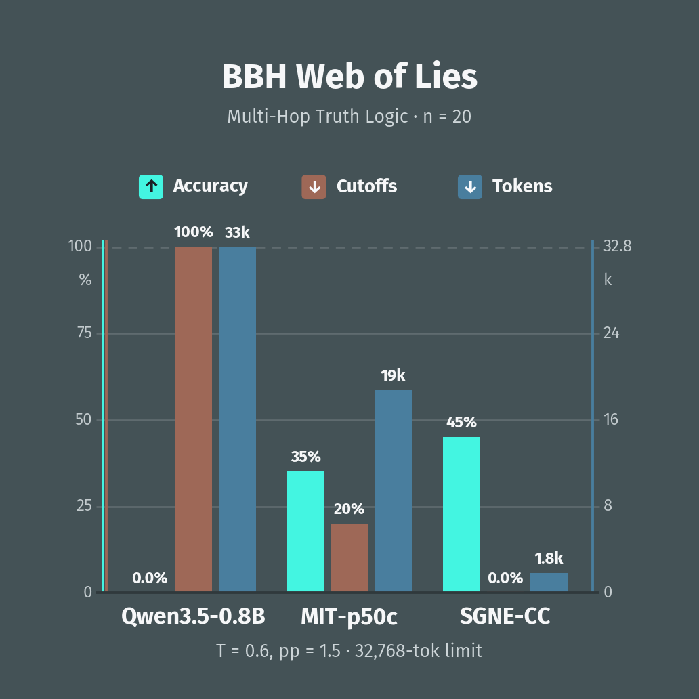
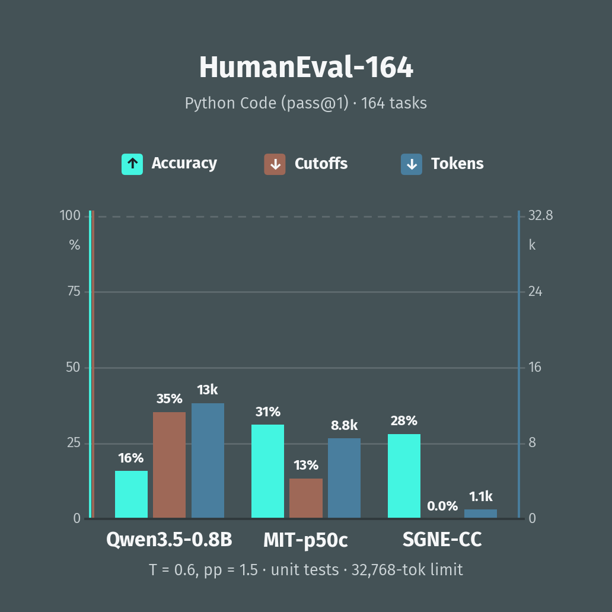
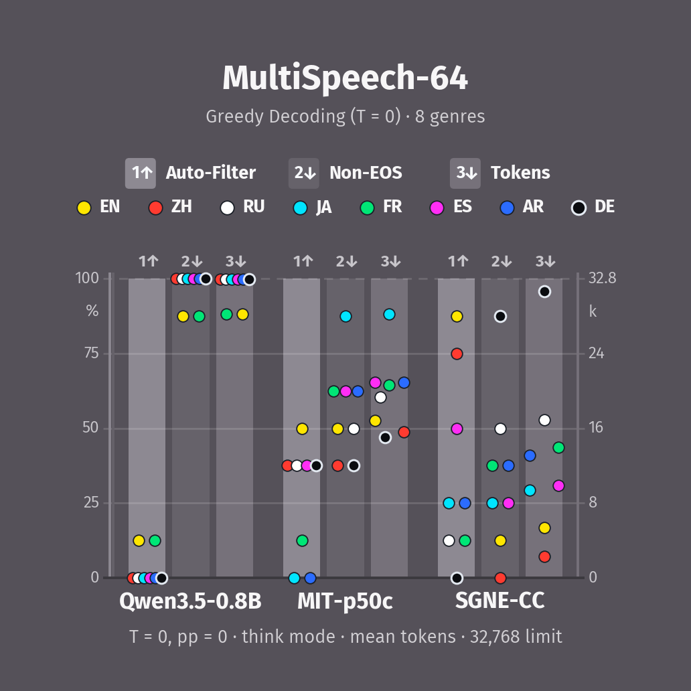
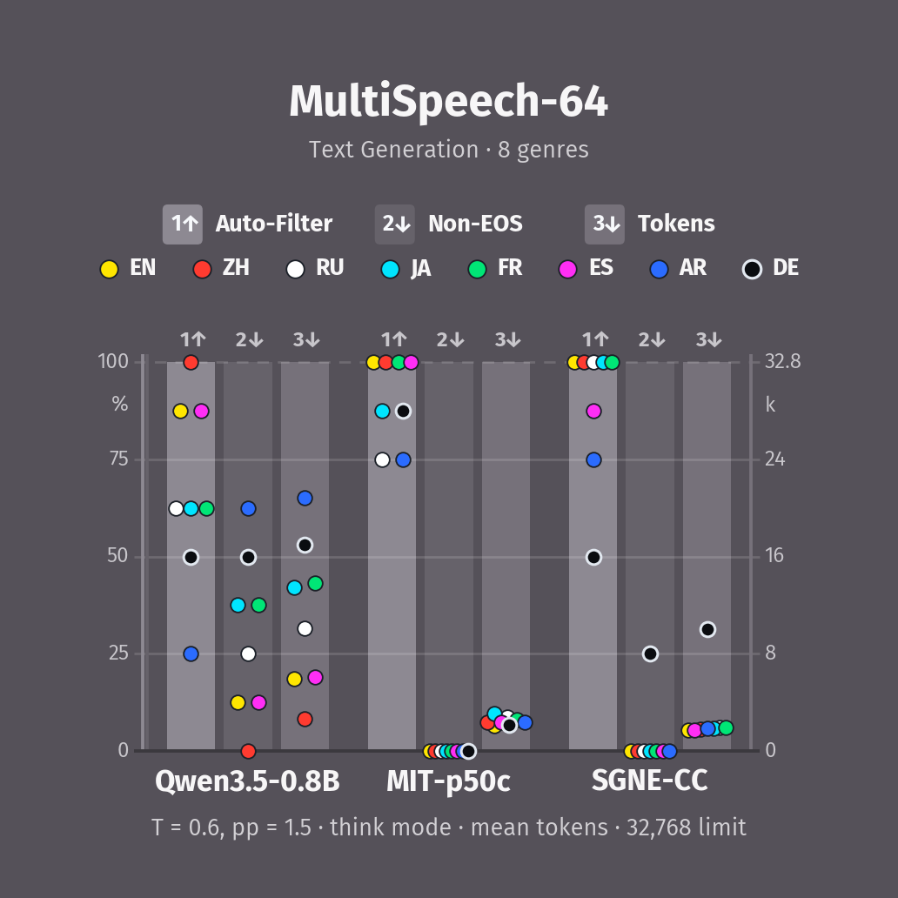

# Weight-Space Audit of MIT-p50c and DNA Weight Editing (SGNE-CC) at a 32,768-Token Generation Limit

> **Language / Язык:** **English** · [Русский](README_RU.md)

Qwen3.5-0.8B is a hybrid language model with 752M text parameters, 18 recurrent GatedDeltaNet layers, and 6 attention layers. In the evaluated BF16 runs, it often leaves its reasoning unfinished at the generation limit of 32,768 new tokens. In MIT CSAIL's [*Sparks of Weight-Space Programming*](https://rikiyat.github.io/blog/weight-space-programming/) (Takehi, Teoh, Zhang, Khattab, 2026; run logs: [RikiyaT/lm_understand-logs](https://github.com/RikiyaT/lm_understand-logs)), the training-free MIT-p50c weight edit raises MATH-500 accuracy from 7.9% to 48.1%, averaged across four vLLM runs using model-card settings: temperature 0.6 and a presence penalty of 1.5 for tokens already used. The base model reaches the length limit in 93.0% of generations in that reference. **Does the reduction in looping persist without random token sampling and a presence penalty? What differences in weight geometry accompany the change in behavior?**

This study audits the weight geometry of MIT-p50c and compares it with **SGNE-CC** (*Spherical Gated Norm-preserving Edit, Column-Constrained*), a 3.13 MiB weight patch obtained without gradient retraining by rotating output columns on their Euclidean spheres while preserving their original lengths. This approach is called **DNA Weight Editing**. All three BF16 models are evaluated at a 32,768-new-token generation limit across mathematics, symbolic logic, Python code generation, and eight-language text generation.

---

## Contents
1. [Geometry of the Weight Edits: MIT-p50c vs. SGNE-CC](#1-geometry-of-the-weight-edits-mit-p50c-vs-sgne-cc)
2. [Mathematics at a 32,768-Token Generation Limit (MATH-500 and MGSM-240)](#2-mathematics-at-a-32768-token-generation-limit-math-500-and-mgsm-240)
3. [Out-of-Domain Transfer: Logic and Code (BBH-160, Web of Lies, HumanEval-164)](#3-out-of-domain-transfer-logic-and-code-bbh-160-web-of-lies-humaneval-164)
4. [8-Language Text Generation (MultiSpeech-64)](#4-8-language-text-generation-multispeech-64)
5. [Method Scope, Conclusion, and Reproducibility (SHA-256)](#5-method-scope-conclusion-and-reproducibility-sha-256)

---

## 1. Geometry of the Weight Edits: MIT-p50c vs. SGNE-CC

Both weight patches are produced by directly modifying the pretrained weights of Qwen/Qwen3.5-0.8B. The model architecture, tokenizer, and inference code remain unchanged; layer indices below start at zero. Geometric properties of both edits can be checked in FP64 double precision from the open patch file `sgne_cc_dna_delta.npz` (3.13 MiB) and the base weights via `python3 apply_dna_patch.py --verify-only` (and side-by-side against the MIT checkpoint via `--compare`):

| Verifiable Weight Property (BF16) | Qwen3.5-0.8B | MIT-p50c | SGNE-CC (DNA Weight Editing) |
| :--- | :---: | :---: | :---: |
| Scalar elements in replacement region (of 752,393,024) | 0 (0%) | 131,072 (0.017%; 130,188 changed) | 2,032,640 (0.270%; 1,993,382 bitwise changed) |
| Edited feed-forward output columns (`mlp.down_proj`) | 0 | 128 (2 layers: indices 15 and 19) | 802 (15 feed-forward layers) |
| Edited recurrent GatedDeltaNet output columns (`out_proj`) | 0 | 0 (0 of 18 layers) | 1,182 (9 recurrent layers) |
| Edited attention output columns (`o_proj`) | 0 | 0 | 0 (0 of 6 layers) |
| Edited recurrent GatedDeltaNet gate rows (of 288) | 0 | 0 | **1** (layer 16, row 12, cosine 0.986582) |
| Column Frobenius norm of update | 0.000000 | 2.239452 | 3.570648 (full 3.574724) |
| Update energy per edited column | 0.0000 | 0.0392 | 0.0064 |
| Relative update norm on edited region | 0.0000 | 0.7349 | 0.2372 (different supports: 128 vs. 1,984 columns) |
| Column rotation angle (median / max) | 0° | 27.1° / 87.3° | **8.8°** / 93.7° |
| First singular mode energy share (layers 15 / 19 / 23) | — | **99.9995% / 99.9991%** / — | **67.58% / 73.43% / 55.92%** |
| Ratio of edited to original column norm | 1.000000 | **[1.002808, 2.142614]** | **[0.998375, 1.001620]** |
| Maximum column norm deviation | 0.0000% | **+114.2614%** (layer 19), **+70.5913%** (layer 15) | **0.1625%** (after BF16 rounding) |
| Minimum column rotation cosine | 1.000000 | 0.047701 (layer 19) | -0.063676 (layer 19, on original-norm sphere) |

Three structural differences separate the two edits:

1. **Column directions and norms.** In each of the two modified feed-forward output matrices of MIT-p50c (layer indices 15 and 19), the first singular mode accounts for over 99.999% of update energy. Individual column norms increase by up to 114.3%, reaching more than twice their pretrained length. In SGNE-CC, column directions are rotated while keeping norms close to their pretrained values: the largest measured deviation after BF16 rounding is about 0.16%, with a median rotation angle of 8.8° and a maximum of 93.7°. Preserving individual column norms does not by itself preserve pairwise angles between columns, output activation magnitudes, or model behavior.
2. **Distribution across feed-forward and recurrent blocks.** Three quarters of Qwen3.5-0.8B's depth consist of recurrent GatedDeltaNet layers, which MIT-p50c leaves untouched. SGNE-CC spreads a multi-rank update across the output matrices of 15 feed-forward layers and 9 recurrent layers, leaving all 6 attention layers unchanged.
3. **Single decay-gate row modification.** In the 13th of the 16 heads at layer index 16, one recurrent gate row is shifted in Euclidean norm from 1.0286 to 1.0452. This change is intended to alter recurrent state retention at the transition from reasoning to the final answer; whether it acts selectively at that boundary requires separate activation-level testing.

> **Working hypothesis.** Multi-step reasoning circuits are already formed in Qwen3.5-0.8B during pretraining, but become trapped inside a recurrent verification loop: output column angles steer reasoning trajectories, while stability across a 32,768-token horizon is linked to preserving the sphere of pretrained column norms. Because the two edits differ simultaneously across several factors — column norms, update rank, layer selection, edited block types, and the gate row in layer 16 — the empirical results below are consistent with this hypothesis, yet do not isolate the causal effect of norm preservation on their own. Direct causal testing requires separate ablations, such as rescaling MIT-p50c's edited columns back to their original lengths.

### Generation Protocol at a 32,768-New-Token Limit
To test sensitivity to decoding settings, two regimes are evaluated with reasoning enabled, one run per task, random seed 0, and a ceiling of 32,768 newly generated tokens. This is the limit on generated output length, not the model's positional context window (262,144 tokens). Decoding parameters are stored in the `sampling` field of the main trace files, and recorded via the author's protocol in the manifest for the two post-freeze holdout files. The two regimes differ jointly in temperature, truncation thresholds, and presence penalty:
* **Greedy decoding** — temperature 0 without random sampling and without a presence penalty: the most probable next token is chosen at every step.
* **Model-card settings** — temperature 0.6, top_p 0.95, top_k 20, and a presence penalty of 1.5 for tokens already used: at each step, 1.5 is subtracted once from the logit of any token that has already appeared in the generated response, regardless of count. Prompt tokens are excluded from this seen-token mask.

All ten benchmark slices across all three models (Qwen3.5-0.8B, MIT-p50c, SGNE-CC) include complete per-item traces from a unified batched PyTorch generator with BF16 weights. Under the author's run protocol, generations were executed on NVIDIA A100 and RTX PRO 6000 Blackwell accelerators in native hardware BF16 (including the entire 100-problem MATH-500 greedy slice), with selected model-card shards run on NVIDIA T4 using FP16 Tensor Core matrix multiplications and FP32 normalizations. Available generation settings and numerical precision modes are documented in `suites/reproducibility_and_holdout_manifest.json`; per-file GPU assignment was not saved inside the trace files and rests on the author's protocol record.

On the full MATH-500 chart (Fig. 2), bars for the base model and MIT-p50c show the external MIT repository reference (four-run vLLM mean), followed immediately below by the direct single-engine PyTorch comparison across all three models. Mathematical answers are graded symbolically with `math-verify`: strict grading (`strict_ok`) requires completed reasoning, normal generation end, and a correct expression in the final answer box; for MGSM, whitespace and thousands separators in integers are normalized beforehand. Section 2.1 also compares the primary and fallback extraction rules from the MIT repository.

---

## 2. Mathematics at a 32,768-Token Generation Limit (MATH-500 and MGSM-240)

Models are first compared under greedy decoding (§2.1), then under model-card settings across the full MATH-500 benchmark (§2.2). Difficulty splits (§2.3–2.4) examine how accuracy and output length vary across problem tiers, and the multilingual MGSM-240 suite (§2.5) tests transfer to word problems across six languages.

### 2.1. Greedy Decoding (MATH-500, 100 Problems, Temperature Zero)

**Fig. 1. At temperature zero without a presence penalty, SGNE-CC finishes generation more often than MIT-p50c.** *Stratified sample of 100 problems across seven MATH-500 subjects; A100, BF16. Strict grading requires completed generation and a correct boxed answer.*

Under strict grading, Base solves none of the 100 problems, MIT-p50c solves 4, and SGNE-CC solves 44: the paired difference is +41/−1 problems (exact paired McNemar test, p = 1.96 × 10⁻¹¹). Mean output lengths for SGNE-CC and MIT-p50c are 6.0k and 31.6k tokens, with generation-limit cutoff rates of 10% and 96%. MIT-p50c leaves reasoning unfinished on 96 of the 100 problems; SGNE-CC does so on 4.

On many problems, MIT-p50c reaches the correct intermediate result early inside its reasoning block, yet never transitions to a final answer. On a problem converting Cartesian coordinates to polar coordinates (`precalculus/807`), MIT-p50c derives the right result near the start of its draft and then repeats an edge-case verification paragraph 451 consecutive times up to the 32,768-token ceiling, leaving the visible answer empty. SGNE-CC writes the correct boxed answer and stops at 2,394 tokens (1,944 in reasoning). This example illustrates the difference in stopping behavior, though a single trace does not explain every error on the benchmark.

| Grading Rule on the 100-Problem MATH-500 Sample (Temperature 0) | Qwen3.5-0.8B | MIT-p50c | SGNE-CC | McNemar (SGNE vs. MIT) |
| :--- | :---: | :---: | :---: | :---: |
| **Strict grading** (closed reasoning, completed generation, and correct boxed answer) | 0% (0/100) | 4% (4/100) | **44%** (44/100) | +41/−1, p = 1.96 × 10⁻¹¹ |
| **MIT primary rule** (MIT answer extraction and symbolic check without requiring generation end) | 1% (1/100) | 5% (5/100) | **44%** (44/100) | +40/−1, p = 3.82 × 10⁻¹¹ |
| **MIT fallback rule** (answer extraction from unfinished reasoning and symbolic check) | 7% (7/100) | 20% (20/100) | **45%** (45/100) | +31/−6, p = 4.13 × 10⁻⁵ |

Because a correct intermediate result can remain inside an unclosed draft, the table reports all three symbolic `math-verify` grading rules. Even under the fallback extraction rule from the MIT repository, SGNE-CC retains a statistically significant lead: 45 of 100 versus 20 of 100 (+31/−6, p = 4.13 × 10⁻⁵). These scores measure completion and answer extraction at temperature zero; they do not bound the base model's latent knowledge or isolate a single stopping mechanism.

**Post-freeze holdout check.** Under the study protocol, at most 200 MATH-500 problems were used during SGNE-CC angle selection and debugging. Disjoint lists of the 200 calibration and 300 untouched problem identifiers are published in `suites/reproducibility_and_holdout_manifest.json` and verified by `scripts/verify_paper_metrics.py`; without an external pre-release timestamp, freeze chronology rests on the author's protocol. From the 300 untouched problems, 49 items (7 per subject) were deterministically sampled via SHA-256 alongside 7 long-form essays of 1,500–2,000 words (`suites/fresh_blind56_32k_suite.json`). On the math subset at temperature zero, SGNE-CC solves 24 of 49 problems while Base solves none (p = 1.19 × 10⁻⁷). Under model-card settings, SGNE-CC again solves 24 of 49, compared with 23 of 49 for MIT-p50c in the direct PyTorch run (+7/−6, p = 1.000) and 25 of 49 in MIT's first external vLLM run (+8/−9, p = 1.000; four-run mean 23.8). Across the seven essays at temperature zero, SGNE-CC closes reasoning on 6 of 7 prompts and finishes generation before the limit on 2 of 7, whereas Base closes none (0 of 7).

### 2.2. Full Run under Model-Card Settings (MATH-500, 500 Problems)

**Fig. 2. Under model-card settings, SGNE-CC generates four times shorter traces than the external MIT-p50c reference, while accuracy comparison depends on the engine.** *Bars for the base model and MIT-p50c show the four-run vLLM mean from the MIT repository; SGNE-CC shows one PyTorch run. Direct single-engine results across all three models are reported below.*

On the same stratified 100-problem sample, switching to model-card settings changes MIT-p50c's score in the direct PyTorch run from 4 to 45 of 100 (+42/−1, p = 1.00 × 10⁻¹¹). Because temperature, top-k/top-p truncation, and presence penalty change together, the isolated effect of the penalty alone is not separated here. SGNE-CC's total stays at 44 of 100, while individual solved problems turn over (+12/−12, p = 1.000): equal totals do not imply identical trajectories.

**Direct PyTorch run and external reference (500 problems).** In the unified PyTorch run across all 500 problems (`traces/math500_*_think32k_card_pp15.jsonl`), Base solves 39 problems (7.8%), MIT-p50c solves 259 (51.8%), and SGNE-CC solves 235 (47.0%; McNemar +56/−80, nominal p = 0.048). SGNE-CC's mean output is 4.0 times shorter: 5.3k versus 21.1k tokens. It reaches the generation limit 17.6 times less often: 1.6% versus 28.2%.

Compared against MIT's first external vLLM run — 241 of 500 (48.2%) — no statistically significant difference from SGNE-CC is detected (+65/−71, p = 0.67). A non-significant p-value does not establish model equivalence, and changing the inference engine and accelerator shifts MIT-p50c's own numbers noticeably: relative to the four-run vLLM mean plotted in Fig. 2, SGNE-CC responses are 4.1 times shorter with 20.7 times fewer cutoffs (an independent H200 measurement reported on the MIT model card gives 51.0% accuracy and 31.6% cutoffs). Across 166 problems with identical extracted answer strings, the published verifier and the MIT logs agree on all 166 verdicts. Among SGNE-CC's cleanly finished responses, 62 omit a final answer box and are marked incorrect under strict grading.

### 2.3. Introductory Difficulty Levels (MATH-500, Levels 1–2, 133 Problems)

**Fig. 3. On lower difficulty levels, MIT-p50c solves more problems at substantially longer output length.** *Direct single-engine comparison across the 133 Level 1–2 problems of MATH-500 under model-card settings.*

On Levels 1–2, MIT-p50c generates 5.6 times more tokens on average: 14.3k versus 2.6k tokens for SGNE-CC. MIT-p50c solves 103 of 133 problems (77.4%) versus 92 (69.2%) for SGNE-CC and 22 (16.5%) for Base; generation-limit cutoffs occur on 17, 1, and 111 responses, respectively. The accuracy gap between the two edits on this slice does not cross the nominal 0.05 threshold (McNemar +11/−22, p = 0.080), and measuring the contribution of repeated arithmetic re-checking would require dedicated draft annotation.

### 2.4. Upper Difficulty Levels (MATH-500, Levels 3–5, 367 Problems)

**Fig. 4. On difficulty levels 3–5, SGNE-CC reaches the generation limit much less often; MIT-p50c solves more problems overall.** *Direct run on the 367 Level 3–5 problems of MATH-500 under model-card settings.*

Across difficulty levels 3–5, 124 of 367 MIT-p50c responses reach the 32,768-token limit (33.8%) compared with 7 for SGNE-CC (1.9%) — 17.7 times fewer cutoffs at 3.7 times shorter mean length (6.3k versus 23.5k tokens). MIT-p50c solves 156 problems (42.5%) and SGNE-CC solves 143 (39.0%; McNemar +45/−58, nominal p = 0.24, which does not establish equivalence), while Base solves 17 (4.6%).

Breakdown by subject within Levels 3–5 is uneven. MIT-p50c leads in elementary and high-school algebra: 96 of 142 (67.6%) versus 77 of 142 (54.2%; +14/−33, nominal p = 0.0079). Across four subjects — intermediate algebra, precalculus, geometry, and counting with probability — the ordering reverses: 37 of 178 (20.8%) for MIT-p50c versus 46 of 178 (25.8%) for SGNE-CC (+23/−14, nominal p = 0.19). In number theory, scores are 23 of 47 (48.9%) versus 20 of 47 (42.6%; +8/−11, nominal p = 0.65). These subject breakdowns are descriptive slices without multiplicity adjustment rather than direct measurements of reasoning depth.

### 2.5. Multilingual Grade-School Word Problems (MGSM-240, 6 Languages)

**Fig. 5. On multilingual word problems, SGNE-CC trails MIT-p50c in total solved count while generating shorter responses.** *Forty story problems translated into six languages (240 total responses under model-card settings; solved totals: 62, 137, and 100). Per-language dot profiles are descriptive and not independent samples.*

On MGSM-240, SGNE-CC solves 100 of 240 language instances (41.7%) versus 137 (57.1%) for MIT-p50c and 62 (25.8%) for Base. SGNE-CC's mean output is 2.8 times shorter (3.1k versus 8.6k tokens), with discordant pairs +15/−52. A naive McNemar test treating all 240 responses as independent would give p = 6.46 × 10⁻⁶, yet the same 40 story problems repeat across six languages. An exact clustered sign-flip permutation test that swaps model labels across each entire six-language problem block confirms that SGNE-CC's accuracy deficit remains statistically significant (two-sided p = 9.04 × 10⁻⁵).

**Inspection of problem-reading errors.** Across the 52 instances solved by MIT-p50c and missed by SGNE-CC, median output lengths are 5,364 and 1,934 tokens, respectively; 17 SGNE-CC responses are shorter than 1,200 tokens, and 2 reach the length limit. Several traces (`mgsm/ru/010, 014, 018, 024`, `mgsm/de/028, 038`, `mgsm/fr/011, 018`) show literal misreadings of verbal comparisons and ratios, yet arithmetic slips, repetition, and long drafts also appear among those misses, so all 52 discrepancies cannot be reduced to a single cause. Scores in Chinese are close (21 of 40 versus 23 of 40), though a 40-problem sample does not identify the source of cross-lingual differences.

---

## 3. Out-of-Domain Transfer: Logic and Code (BBH-160, Web of Lies, HumanEval-164)

Under the study protocol, both weight patches were selected solely on mathematical tasks: this is documented in the MIT paper for MIT-p50c, and recorded in `suites/reproducibility_and_holdout_manifest.json` for SGNE-CC. The three evaluations below test transfer of the fixed models to symbolic logic and Python code synthesis under model-card settings.

### 3.1. Symbolic Logic (BBH-160, 8 Subtasks)

**Fig. 6. Both edits multiply solved logic counts over Base, while SGNE-CC generates substantially shorter responses than MIT-p50c.** *Eight BIG-Bench Hard subtasks of 20 problems each (160 problems total under model-card settings), normalized answer grading.*

Transfer from mathematics to symbolic logic appears in both training-free edits: Base solves 3 of 160 problems (1.9%), MIT-p50c solves 81 (50.6%), and SGNE-CC solves 66 (41.3%). The accuracy gap between the two edits falls just short of the nominal 0.05 threshold (McNemar +20/−35, p = 0.058), while SGNE-CC's mean output is 6.9 times shorter (2.4k versus 16.9k tokens) with 23 times fewer cutoffs (1 response versus 23 for MIT-p50c and 154 for Base). When reading the raw trace files, note that the saved numeric `strict_ok` flag zeroes out verbal True and False answers in the boolean-expressions subtask, lowering both edits symmetrically by 7.5–9.4 percentage points without changing the statistical conclusion (+19/−31, p = 0.12).

### 3.2. Truth-and-Lie Chains (BBH Web of Lies)

**Fig. 7. On Web of Lies, all twenty SGNE-CC responses finish before the limit, with nine of twenty correct.** *Sequential boolean inference across chains of statements (20 problems from BBH); four MIT-p50c responses hit the length limit.*

Tracking negations along chains of liars and truth-tellers separates failure patterns. SGNE-CC finishes all 20 generations with zero cutoffs, uses 10.4 times fewer tokens, and significantly outperforms Base's zero score (9 of 20 versus 0 of 20, p = 0.0039), with no statistically significant difference detected against MIT-p50c on this small sample (9 versus 7, McNemar +4/−2, p = 0.69). MIT-p50c's four truncated responses reveal looping after reasoning has already closed: on item `bbh/web_of_lies/000`, the model finishes its draft at token 18,833 and spends the remaining 13.9k tokens up to 32,768 repeating the same sentence about a character's truthfulness without producing a final answer.

### 3.3. Python Code Generation (HumanEval-164, Unit Tests)

**Fig. 8. On Python code generation, SGNE-CC shortens reasoning by 14 times and finishes every response; no statistically significant difference in unit-test pass rate against MIT-p50c is detected.** *Full 164-problem HumanEval suite under model-card settings, archived run of canonical Python unit tests.*

A fixed presence penalty of 1.5 does not by itself prevent repetition runs, because next-token choice depends on relative candidate logits and accumulated layer states. Across eight unfinished MIT-p50c responses, raw outputs contain multi-thousand-token runs of a single character right up to the 32,768 ceiling — spaces (`HumanEval/24`, `HumanEval/159`), closing parentheses `')))))...'` (`HumanEval/61`), or nines `'99999...'` (`HumanEval/144`). The internal weight mechanism behind these runs was not separately measured.

**Unit-test and code-extraction breakdown.** According to the archived unit-test report (recorded in `suites/reproducibility_and_holdout_manifest.json` and reproducible inside an isolated container via `scripts/grade_humaneval_sandbox.py`), Base passes 26 of 164 problems (15.9%), MIT-p50c passes 51 (31.1%), and SGNE-CC passes 46 (28.0%). No statistically significant difference is detected between SGNE-CC and MIT-p50c (McNemar +13/−18, p = 0.47, which does not establish equivalence); both edits significantly exceed Base (nominal p ≤ 0.0029). SGNE-CC's mean reasoning length is 14.1 times shorter (449 versus 6,334 tokens), and its cutoff rate is 0% versus 13.4% (22 of 164 responses) for MIT-p50c. Candidate function code is extracted from all 164 SGNE-CC responses, with 158 passing static `ast.parse` syntax checks and 6 raising syntax errors (in the archived test run, failures broke down into 81 `AssertionError`, 28 `RuntimeError`, 7 `SyntaxError`, and 2 timeouts). MIT-p50c leaves 8 unclosed reasoning blocks and 1 response without extractable code (155 of 164 extracted, 151 syntactically valid); Base leaves 56 unclosed reasoning blocks.

---

## 4. 8-Language Text Generation (MultiSpeech-64)

MultiSpeech-64 spans 8 applied writing genres across 8 languages (Russian, English, Chinese, German, Spanish, French, Japanese, and Arabic), totaling 768 responses across three models and four decoding modes. An automated filter credits a response when all formal conditions hold simultaneously: reasoning is closed, generation reaches normal completion, the visible answer is non-empty, repeated eight-character sequences stay at or below 25% (and repeated four-word sequences at or below 20% for space-delimited scripts), and the check detects no foreign-script insertions. This filter measures **formal generation stability**, not semantic coherence, factual accuracy, or instruction following — content failures are examined separately below. With 8 prompts per language, per-language profiles are descriptive.

### 4.1. Greedy Decoding (Temperature Zero)

**Fig. 9. At temperature zero, both edits raise the share of formally completed texts over Base, with marked variation across languages.** *Eight languages across eight genres without random sampling or a presence penalty; 2, 17, and 23 of 64 responses pass the automated filter.*

Without random sampling or a presence penalty, both edits multiply the automated-filter pass rate over Base (p < 10⁻⁴): Base passes 2 of 64 prompts (3.1%), MIT-p50c passes 17 (26.6%), and SGNE-CC passes 23 (35.9%; McNemar +11/−5, p = 0.21). Counting languages with zero passed prompts (0 of 8), Base fails completely on six of eight languages, MIT-p50c on two (Japanese and Arabic), and SGNE-CC on one (German). Numerically, SGNE-CC scores higher on five languages (English, Chinese, Spanish, Japanese, and Arabic), ties MIT-p50c on French, and trails on Russian and German. Failure patterns differ across the three models:
* **Base Qwen3.5-0.8B stalls inside reasoning.** In 60 of 64 prompts, the visible answer is empty: all 32,768 tokens are spent inside the draft, reaching normal completion only twice.
* **MIT-p50c finishes reasoning but loops in visible text.** Reasoning remains unclosed in 22 of 64 prompts (with normal completion in 28), yet without a presence penalty the model repeats lines inside the visible response: in the Arabic formal letter (`ar/formal_letter`) it inflates the form header `**الاسم:** [الاسم الكامل]` to 68.5k characters, in English popular science (`en/pop_science`) it repeats a paragraph to 134.2k characters, and in the Chinese brief (`zh/structured_brief`) it repeats `扶手、扶手...` (“armrest”) until the length ceiling.
* **SGNE-CC leaves fewer unclosed reasoning blocks:** 5 cases versus 22 for MIT-p50c (4.4 times fewer; 6 empty visible answers total), reaching normal completion on 42 of 64 prompts. On the three prompts above, SGNE-CC produces compact finished texts, lowering median length across the suite to 2,235 tokens versus 32,768 for MIT-p50c (mean 13,011 versus 20,173). At temperature zero, SGNE-CC shows a higher rate of paired asterisks (16.5 versus 5.6 per 1,000 characters, a count that includes ordinary Markdown emphasis) and retains repetition failures in German; on the Russian historical portrait (`ru/historical_portrait`), all three models leave reasoning unfinished at temperature zero.

### 4.2. Model-Card Settings: Repetition, Script Insertions, and Factual Distortions

**Fig. 10. Under model-card settings, both edits close reasoning on every prompt while retaining isolated repetition failures and foreign-script insertions.** *43, 58, and 57 of 64 responses pass the automated filter; the formal filter does not verify factual accuracy.*

Under model-card settings, neither MIT-p50c nor SGNE-CC leaves any unfinished reasoning blocks (0 of 64 versus 13 of 64 for Base). No difference is detected between the two edits on the formal filter (58 of 64 versus 57 of 64, p = 1.000), and both significantly exceed Base (43 of 64, nominal p < 0.005). SGNE-CC has a lower median length (1,861 versus 2,311 tokens) but a higher mean (2,910 versus 2,509 tokens) due to two German responses reaching the 32,768 limit. In a greedy control run with reasoning disabled and a 4,096-token limit, no significant differences appear among the three models (p ≥ 0.48 across all pairs), though that control is bounded by 64 prompts and a surface filter.

**Content limitations.** First, under model-card settings, MIT-p50c produces three responses with Chinese characters inserted mid-word into Russian and Arabic prose («сохранять стабильную航速 при низких температурах», `يحقق双赢`, `| المهمة |责任人 |`), while SGNE-CC produces two in Arabic (`نصف的量`, `قواعد定期`) and none in Russian (8 of 8). Whether the presence penalty directly causes these insertions can only be tested by varying that parameter alone. Second, four of SGNE-CC's five remaining repetition-threshold failures occur in German (4 of 8, plus one in Spanish); linking this pattern to German compound nouns remains an untested hypothesis. Third, on `ru/historical_portrait`, although Fridtjof Nansen is named explicitly in the prompt, SGNE-CC replaces his name with “fleet commander **F. 1895**” and finishes cleanly, passing the automated filter. This case shows that formal completion guarantees neither instruction fidelity nor preservation of prompt facts.

---

## 5. Method Scope, Conclusion, and Reproducibility (SHA-256)

### What DNA Weight Editing Establishes — and What It Does Not
1. **Observed behavior.** The fixed SGNE-CC weight patch substantially reduces output length and 32,768-token cutoff rates across several evaluations, including greedy decoding at temperature zero without a presence penalty (the 100-problem MATH-500 sample and the 49 holdout problems). The causal contribution of column norm preservation relative to the patch's other factors, as well as any effect on latent factual recall, is not established by these comparisons.
2. **Length and accuracy trade-offs.** Relative accuracy depends on the task family and decoding mode. SGNE-CC trails MIT-p50c significantly on multilingual MGSM-240 word problems and scores numerically lower in direct PyTorch model-card runs on full MATH-500, BBH-160, and HumanEval-164; conversely, at temperature zero without a presence penalty, SGNE-CC holds a large lead. These regimes must be reported separately rather than compressed into a uniform “shorter without loss” claim.
3. **Independent artifact verification.** The rotation-angle search procedure is not released, whereas the BF16 weight patch (`sgne_cc_dna_delta.npz`), partition manifest, benchmark suites, and all 26 trace files (37 files locked by SHA-256 checksums) are fully public. Weight geometry and all saved-trace metrics can be verified locally on a CPU; re-running GPU generation and executing model-generated code in a sandbox remain separate procedures.

### Protocol Limitations
* **One run per task.** All direct PyTorch runs record one output per prompt (seed 0), so seed-to-seed variance inside the PyTorch generator is unmeasured; four external vLLM runs are available for the MIT reference on full MATH-500.
* **Hardware protocol and statistics.** Direct traces were generated with a shared batched runner across several accelerators: under the author's protocol, A100 and RTX PRO 6000 Blackwell in hardware BF16 (including all 100-problem greedy MATH-500 traces) and selected model-card shards on T4 using FP16 matrix multiplications. Available decoding parameters, prompt templates, and numerical modes are documented in `suites/reproducibility_and_holdout_manifest.json`, while per-file GPU assignment was not stored inside the trace files. An independent re-run at temperature zero in vLLM remains a useful external check. All p-values across subsets and subject slices are nominal without multiplicity correction; p > 0.05 indicates an undetected difference at the given sample size rather than proof of model equivalence.
* **Code execution safety.** `scripts/grade_humaneval_sandbox.py` runs model-generated Python code under the current user account (`python -I` isolates Python import paths, not the filesystem or network). Run it solely inside a disposable container or virtual machine.

### Conclusion
Comparing these fixed weight edits shows that distinct weight-space geometries coincide with substantial differences in generation length and termination behavior. Across the evaluated regimes, SGNE-CC reaches completion before the token limit more consistently and typically generates shorter traces than MIT, though whether norm preservation causes this behavior still requires isolated testing. Shorter generation comes with lower accuracy on several task classes, and formally terminated text can still distort prompt facts. Releasing the open weight patch and raw traces lets readers verify both the artifact geometry and the reported measurements while keeping empirical observations distinct from mechanistic hypotheses.

### Artifact Checksums (SHA-256), Licensing, and Offline Verification
* Archival Zenodo deposit (bilingual paper, `sgne_cc_dna_delta.npz` patch, and complete repository archive): [DOI 10.5281/zenodo.24235218](https://doi.org/10.5281/zenodo.24235218).
* Author code, the weight patch file, and manuscript text are open under **Apache-2.0** ([`LICENSE`](LICENSE)). Included or adapted third-party code, datasets, and reference logs retain their original licenses; sources and notices are listed in [`NOTICE`](NOTICE) and [`THIRD_PARTY_LICENSES.md`](THIRD_PARTY_LICENSES.md).
* Base model: Qwen/Qwen3.5-0.8B (752,393,024 text parameters, BF16). Verified files: `model.safetensors` — `04b1c301231dd422b8860db31311ab2721511346a32cb1e079c4c4e5f1fe4696`; `config.json` — `b90b86f35c8e6925ef74ee04d0e758f0a845c83a42089ad82bbaa948de9b4204`; `tokenizer.json` — `5f9e4d4901a92b997e463c1f46055088b6cca5ca61a6522d1b9f64c4bb81cb42`.
* SGNE-CC weight patch (`sgne_cc_dna_delta.npz`, 3.13 MiB, modified columns and gate row in BF16): `4e4d36e032869bc10f56e2a2033a52d3f2774321cf867ef6f74274a7c0d1566d`
* Reproducibility, 200/300 MATH-500 split, and archived test manifest (`suites/reproducibility_and_holdout_manifest.json`): `ac6440486e51e684b2bd19738f8e8f7a7175fdb7cc3f36d1515d83fe250d8833`
* Comparison checkpoint MIT-p50c: distributed separately by the MIT authors on Hugging Face ([RikiyaT/Qwen3.5-0.8B-weight-space-programming](https://huggingface.co/RikiyaT/Qwen3.5-0.8B-weight-space-programming)) and supported via `--compare` in `apply_dna_patch.py`.
* MATH-500, full model-card run (Base / MIT / SGNE): `6d06d373c429c760584a553ebf9ed26a639f42ee64b4ce72b86d0c49fc3c113c` / `2c766bf006030cb15dd6d8256534ca6ad730b8a780d9c058872d09d9b150ffb6` / `8f4fed10df896a6ffe5f367982f23d88625cdee1b3cba5a40801626ce3b7be9a`
* MATH-500, 100-problem sample at temperature 0 (Base / MIT / SGNE): `8df959b204995ca909f68533c1bb857f4e9a2a04789cf9dc27b8bb46fede68fd` / `4634cb4a5234cfce5627d8b31b6e103d28ebac009735e5c3475b6ac7913aeb26` / `bf1a30e67cf900fbb892c5b4ac6ed7220fc64d8ef2e87e29ec6b6fa69187f350`
* Holdout suite (`suites/fresh_blind56_32k_suite.json` and Base / SGNE traces): `63ba2cf247934afbc767865a5727eb403bbbc6af3205d44d3e755fe849a43e89` (`58d0db19f5d3d95dea9e4cb39b9a66979cfaef01a5235be8ed4b9945b1064ec0` / `2072450af148d124fb09f9698d9eb137b933f44014f125e91f394709d7e5a14e`)
* HumanEval-164 (Base / MIT / SGNE): `b2fd764fe9f681567a0d35a3251f484f9969c9149b63044589773e178369b041` / `dd1c6ea407d53ce0a4b9e22f5ec9436c2984419b074ac847c273293b1f0c4a13` / `fc67fef2e2db445be97d94c6ac23981b848f557d10e981a0d043a06767c42106`
* MGSM-240 and BBH-160 (Base / MIT / SGNE): `8e7fa9ece63a7de7399b786dc53df8a1c1287e049bbea25e612a836c996fe23e` / `317556c3dd0e42b2561c37cd36d82e847a3fa2884523508e02348b0f9c96ba64` / `a8936581d18a482b773ad40f71cd6bfc59e93a5bc57280b44e3d30a963a93767`
* MultiSpeech-64 at temperature 0 (Base / MIT / SGNE): `13fece99c98ae619687cf71970b45d52b326d751a536d2ce678b56cd4e6c994d` / `a2574d87d70ec5da102be1be12dd8c2de7c7fdfa29fa6a523be1ed863422408d` / `f9f27c9b36c53b4605b5d57eb2d6aa81f4a9c845269b065995b495c2d60c2a29` *(all 37 tracked files, including the weight patch and manifest, are automatically verified via SHA-256 by `scripts/verify_paper_metrics.py`)*.
* Standalone model assembly and local CPU verification without a GPU (`pip install -r requirements.txt`):
  * Assemble a ready-to-use BF16 checkpoint for Transformers, vLLM, or SGLang: `python3 apply_dna_patch.py --out ./Qwen3.5-0.8B-SGNE-CC` (pass `--base-model <path>` if already downloaded locally; otherwise Qwen/Qwen3.5-0.8B is downloaded from Hugging Face and SHA-256-verified).
  * Verify FP64 weight geometry in memory without writing a 1.75 GB copy: `python3 apply_dna_patch.py --verify-only` (add `--compare RikiyaT/Qwen3.5-0.8B-weight-space-programming` or a local folder path for side-by-side comparison with MIT-p50c).
  * Verify all 37 SHA-256 checksums and recompute saved-trace metrics: `python3 scripts/verify_paper_metrics.py`.
  * Re-run HumanEval-164 unit tests (executes model-generated code — run inside an isolated container): `python3 scripts/grade_humaneval_sandbox.py`.

---

## Supporting the Research

Donations support the open [DOT](https://github.com/Nondual-Observer/DOTheory) project by an independent developer. Support helps:

- conduct larger computational experiments;
- develop theoretical formalization;
- create reproducible research tools;
- publish “For Dummies: How to Prompt an AGI”.

It also makes it possible to dedicate more time to the research and preserve its independent, open character.

| Currency | Network | Address |
|---|---|---|
| Bitcoin | BTC | `bc1qlaxsrum7fxpml57nsrtkjfkkxl5v3xtj4d0uxe` |
| USDT | TRC20 | `TM8U2EqVaT3tjvG6NyuKTqY4F5qc2A69Sy` |
| Ethereum | ETH | `0x4fFc68f0d55d19Fa5EBd5f6570a41E100aFe4a98` |
