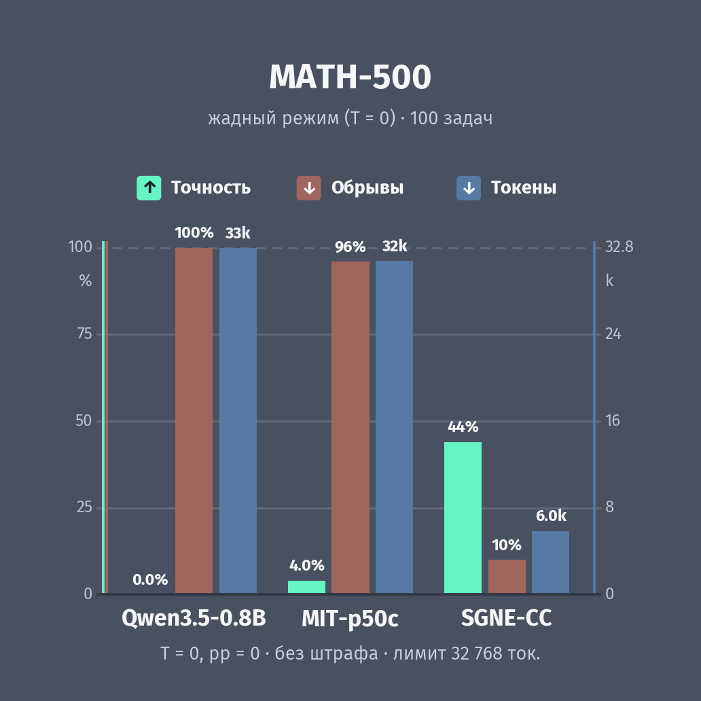
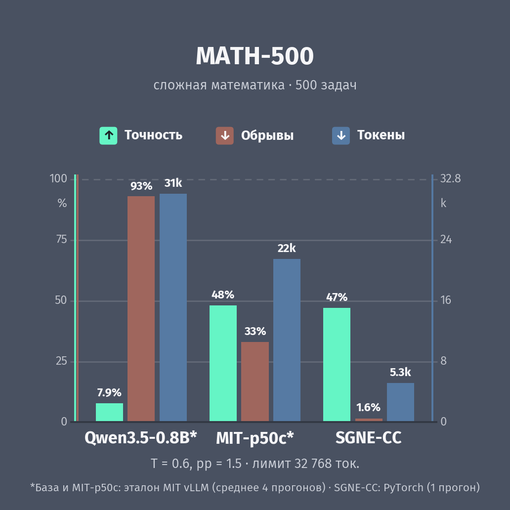
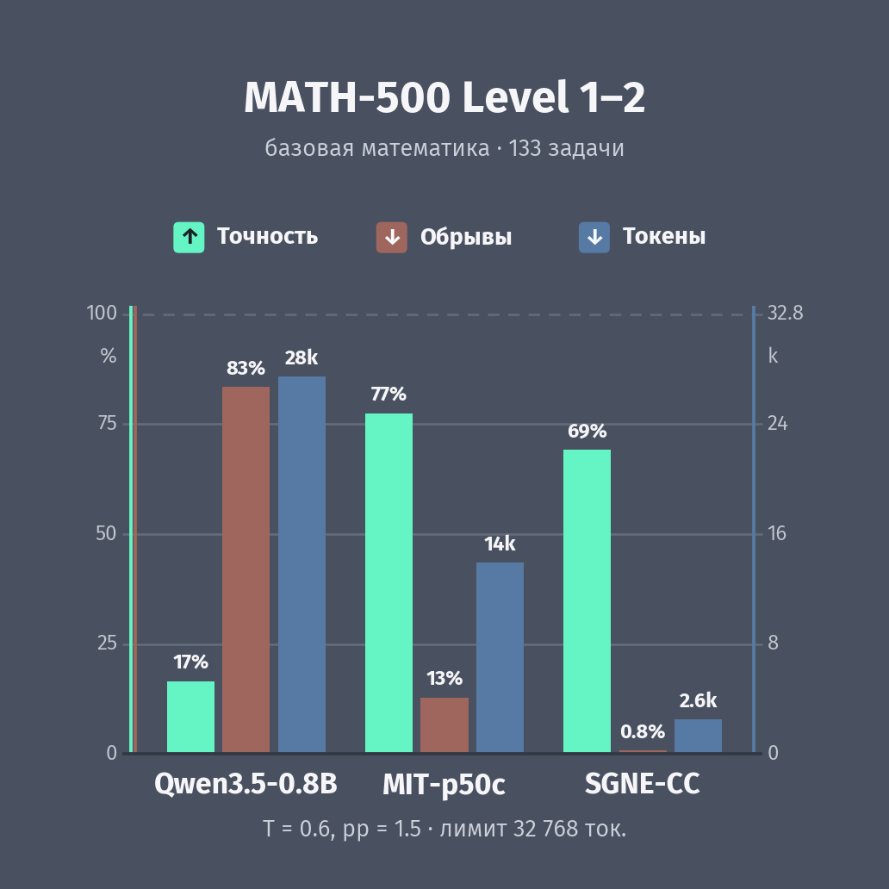
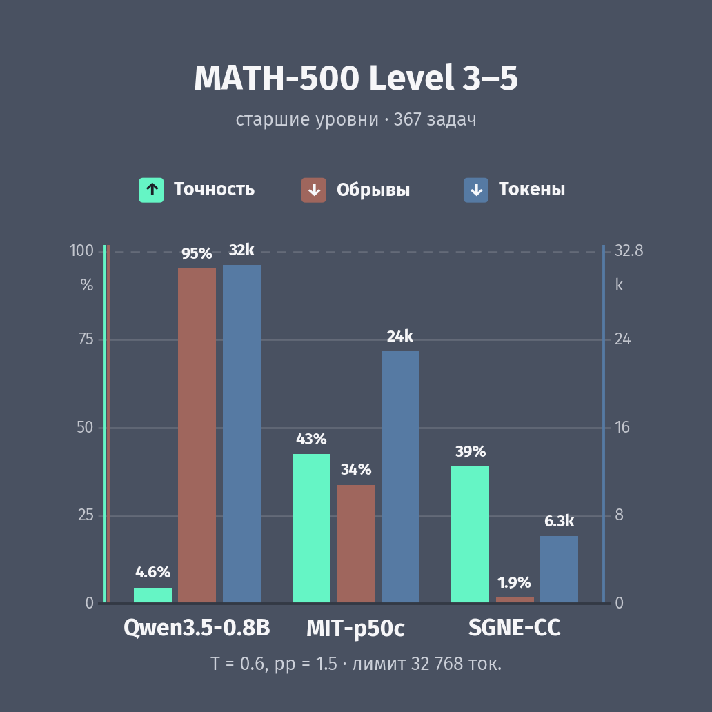
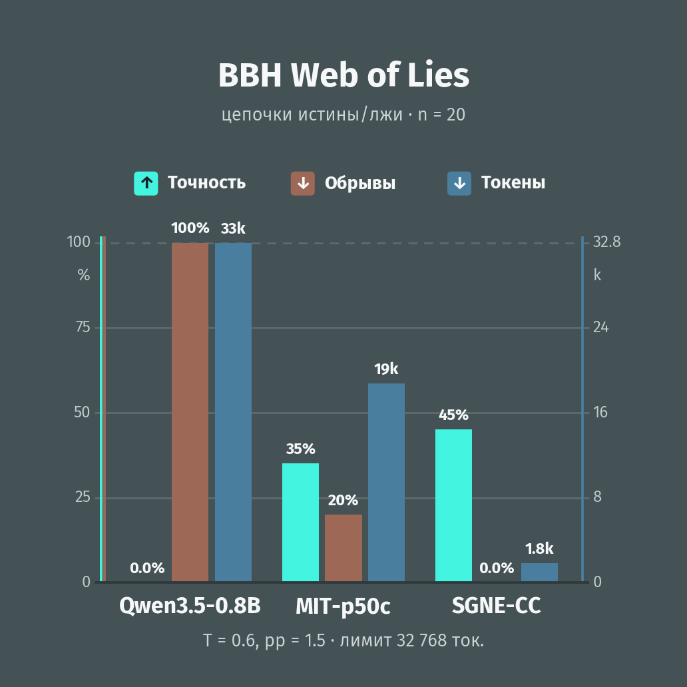
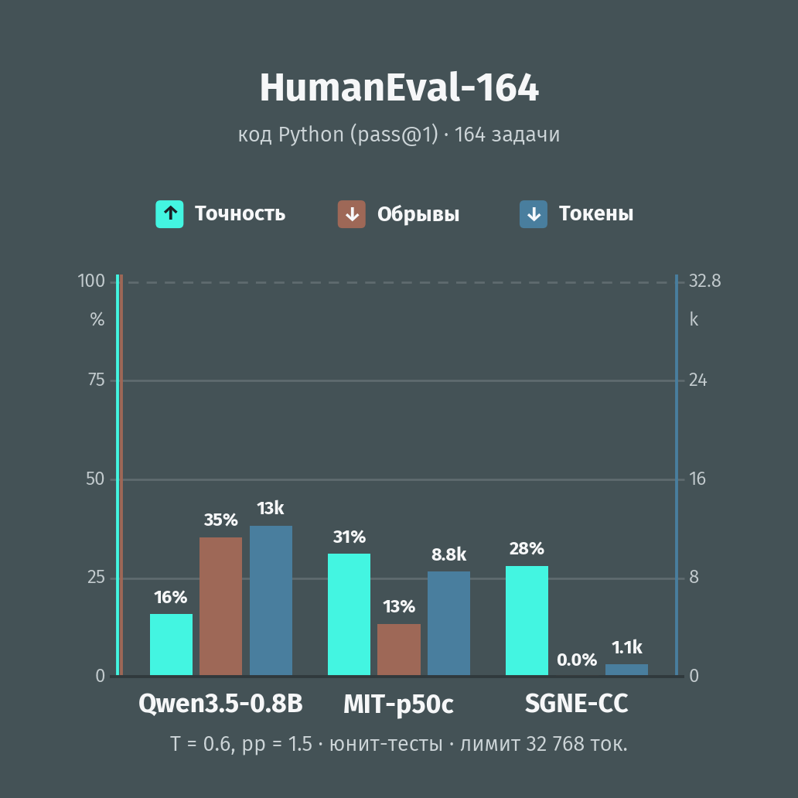
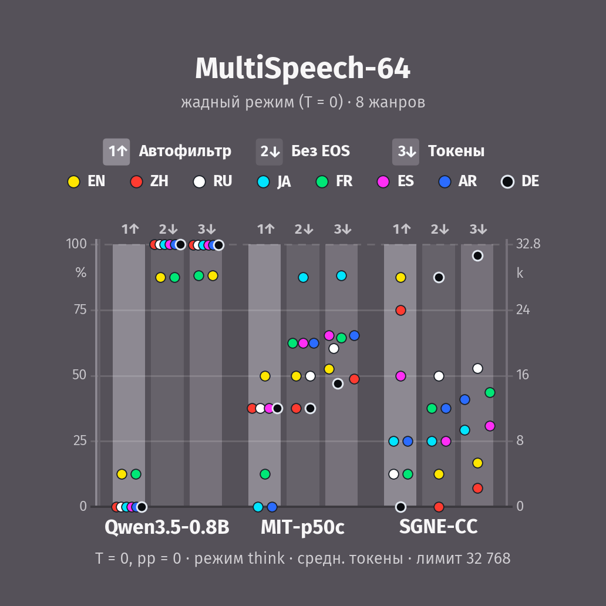
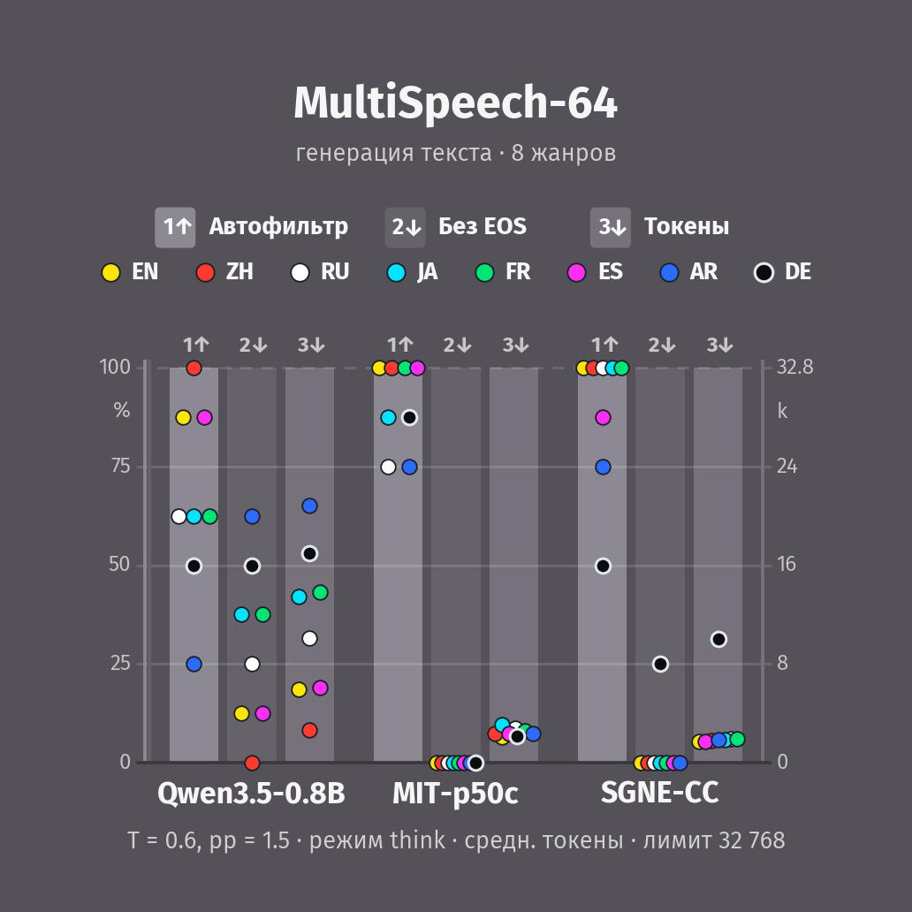

# Аудит весовой правки MIT-p50c и ДНК-редактирование весов (SGNE-CC) при лимите генерации 32 768 токенов

> **Language / Язык:** [English](README.md) · **Русский**

Qwen3.5-0.8B — гибридная модель с 752 млн параметров текстовой части, 18 рекуррентными слоями GatedDeltaNet и 6 слоями внимания. В проверенных прогонах с весами BF16 она часто не завершает размышление до установленного лимита в 32 768 новых токенов. В работе MIT CSAIL [*Sparks of Weight-Space Programming*](https://rikiyat.github.io/blog/weight-space-programming/) (Takehi, Teoh, Zhang, Khattab, 2026; журналы прогонов: [RikiyaT/lm_understand-logs](https://github.com/RikiyaT/lm_understand-logs)) прямая правка весов без дообучения MIT-p50c повышает точность на MATH-500 с 7.9% до 48.1% — в среднем по четырём прогонам vLLM с настройками из карточки модели: температурой 0.6 и штрафом присутствия 1.5 за уже использованные токены. Базовая модель в этом эталоне достигает предела длины в 93.0% генераций. **Сохраняется ли сокращение зацикливания без случайного выбора токенов и штрафа присутствия? Какие различия в геометрии весов сопровождают изменение поведения?**

В настоящей работе проверяется геометрия весов MIT-p50c и сопоставляется альтернативная поправка объёмом 3.13 МиБ — **SGNE-CC** (*Spherical Gated Norm-preserving Edit, Column-Constrained* — сферическая весовая поправка с сохранением норм и рекуррентными воротами), полученная без градиентного дообучения поворотом выходных столбцов на сферах их исходной длины. Этот способ назван **ДНК-редактированием весов**. Три модели в формате BF16 сравниваются при лимите генерации 32 768 новых токенов в математике, символической логике, генерации кода на Python и генерации текстов на восьми языках.

---

## Содержание
1. [Геометрия весовых правок: MIT-p50c против SGNE-CC](#1-геометрия-весовых-правок-mit-p50c-против-sgne-cc)
2. [Математика при лимите генерации 32 768 токенов (MATH-500 и MGSM-240)](#2-математика-при-лимите-генерации-32-768-токенов-math-500-и-mgsm-240)
3. [Перенос на логику и код (BBH-160, Web of Lies, HumanEval-164)](#3-перенос-на-логику-и-код-bbh-160-web-of-lies-humaneval-164)
4. [Генерация текстов на 8 языках (MultiSpeech-64)](#4-генерация-текстов-на-8-языках-multispeech-64)
5. [Границы метода, заключение и воспроизводимость (SHA-256)](#5-границы-метода-заключение-и-воспроизводимость-sha-256)

---

## 1. Геометрия весовых правок: MIT-p50c против SGNE-CC

Обе весовые поправки получены прямым изменением заводских весов Qwen/Qwen3.5-0.8B. Архитектура, токенизатор и программа исполнения модели остаются прежними; нумерация слоёв ниже начинается с нуля. Геометрические характеристики проверяются в двойной точности FP64 по открытому файлу поправки `sgne_cc_dna_delta.npz` (3.13 МиБ) и базовым весам командой `python3 apply_dna_patch.py --verify-only` (а при наличии чекпоинта MIT — бок о бок с флагом `--compare`):

| Проверяемый параметр весов (BF16) | Qwen3.5-0.8B | MIT-p50c | SGNE-CC (ДНК-редактирование) |
| :--- | :---: | :---: | :---: |
| Скалярных элементов в области замены (из 752 393 024) | 0 (0%) | 131 072 (0.017%; изменены 130 188) | 2 032 640 (0.270%; побитово изменены 1 993 382) |
| Выходных столбцов полносвязных блоков (`mlp.down_proj`) | 0 | 128 (2 слоя: индексы 15 и 19) | 802 (15 полносвязных слоёв) |
| Выходных столбцов рекуррентных блоков GatedDeltaNet (`out_proj`) | 0 | 0 (0 из 18 слоёв) | 1 182 (9 рекуррентных слоёв) |
| Выходных столбцов слоёв внимания (`o_proj`) | 0 | 0 | 0 (0 из 6 слоёв) |
| Строк рекуррентных ворот GatedDeltaNet (из 288) | 0 | 0 | **1** (слой 16, строка 12, косинус 0.986582) |
| Норма Фробениуса поправки по столбцам | 0.000000 | 2.239452 | 3.570648 (полная 3.574724) |
| Удельная энергия приращения на столбец | 0.0000 | 0.0392 | 0.0064 |
| Относительная норма поправки на выбранной области | 0.0000 | 0.7349 | 0.2372 (области разные: 128 против 1 984 столбцов) |
| Угол поворота столбца (медиана / максимум) | 0° | 27.1° / 87.3° | **8.8°** / 93.7° |
| Доля первой сингулярной моды (слои 15 / 19 / 23) | — | **99.9995% / 99.9991%** / — | **67.58% / 73.43% / 55.92%** |
| Диапазон отношения нормы столбца к исходной | 1.000000 | **[1.002808, 2.142614]** | **[0.998375, 1.001620]** |
| Максимальное отклонение нормы столбца | 0.0000% | **+114.2614%** (слой 19), **+70.5913%** (слой 15) | **0.1625%** (после округления в BF16) |
| Минимальный косинус поворота столбца | 1.000000 | 0.047701 (слой 19) | -0.063676 (слой 19, на сфере исходной длины) |

Между двумя правками есть три конструктивных различия:

1. **Направления и нормы столбцов.** В каждой из двух изменённых выходных матриц полносвязных блоков MIT-p50c (слои с индексами 15 и 19) на первую сингулярную моду приходится свыше 99.999% энергии приращения. Нормы отдельных столбцов при этом увеличены на величину до 114.3% — более чем вдвое относительно исходных. В SGNE-CC поворачиваются направления столбцов при сохранении исходных норм: максимальное измеренное отклонение после округления координат в BF16 составляет около 0.16%, медианный угол поворота равен 8.8°, максимальный — 93.7°. Сохранение норм отдельных столбцов само по себе не сохраняет взаимные углы между ними, величину выходных активаций и поведение модели.
2. **Распределение между полносвязными и рекуррентными блоками.** Три четверти глубины Qwen3.5-0.8B составляют рекуррентные слои GatedDeltaNet, которые в MIT-p50c остаются нетронутыми. В SGNE-CC многомерная поправка распределена между выходными матрицами 15 полносвязных и 9 рекуррентных слоёв; все 6 слоёв внимания оставлены без изменений.
3. **Изменение одной строки ворот затухания.** В 13-й из 16 голов слоя с индексом 16 изменена одна строка рекуррентных ворот: её евклидова норма сдвинута с 1.0286 до 1.0452. Поправка рассчитана на изменение удержания рекуррентного состояния при переходе от размышления к чистовому ответу; действует ли она избирательно именно на этой границе, требует отдельной проверки на активациях.

> **Рабочая гипотеза.** Цепи многошагового рассуждения уже сформированы в Qwen3.5-0.8B при предобучении, но удерживаются внутри цикла самопроверки: углы выходных столбцов меняют траекторию рассуждения, а устойчивость на горизонте 32 768 токенов связана с сохранением сферы исходных норм. Поскольку две правки различаются сразу по нескольким признакам — нормам столбцов, рангу поправки, набору слоёв, типам затронутых блоков и строке ворот в слое 16 — приведённые ниже результаты согласуются с этой гипотезой, но не доказывают причинный вклад сохранения норм отдельно от остальных факторов. Для прямой проверки нужны отдельные опыты, например приведение изменённых столбцов MIT-p50c к их исходной длине.

### Протокол генерации с лимитом 32 768 новых токенов
Для проверки чувствительности к настройкам генерации используются два режима с включённым размышлением, одним прогоном на задачу, начальным зерном 0 и пределом 32 768 новых токенов. Это предел длины генерируемого ответа, а не позиционного окна модели (262 144 токена). Настройки записаны в поле `sampling` основных файлов трасс, а для двух файлов отложенной проверки зафиксированы по протоколу автора в манифесте. Два режима одновременно различаются температурой, порогами отсечения и штрафом присутствия:
* **Жадный режим** — температура 0 без случайного выбора токенов и без штрафа присутствия: на каждом шаге выбирается наиболее вероятный токен.
* **Режим карточки модели** — температура 0.6, пороги top_p 0.95 и top_k 20, штраф присутствия 1.5 за уже использованные токены: на каждом шаге из логита любого токена, уже встретившегося в сгенерированном ответе, однократно вычитается 1.5 независимо от числа повторов. Токены входного запроса в этот счётчик не входят.

Все десять срезов по трём моделям (Qwen3.5-0.8B, MIT-p50c, SGNE-CC) сопровождаются полными позадачными трассами единого батчевого генератора на PyTorch с весами в BF16. По протоколу автора прогоны выполнены на ускорителях NVIDIA A100 и RTX PRO 6000 Blackwell в аппаратном BF16 (включая всю стратифицированную сотню MATH-500 при нулевой температуре), а часть шардов в режиме карточки модели — на NVIDIA T4 с матричными умножениями в FP16 и нормировками в FP32. Доступные параметры генерации и описание численных режимов собраны в `suites/reproducibility_and_holdout_manifest.json`; привязка отдельных файлов трасс к конкретным ускорителям в самих файлах не сохранена и опирается на протокол автора.

На графике полного MATH-500 (Рис. 2) столбики базовой модели и MIT-p50c показывают внешний эталон из репозитория MIT (среднее четырёх запусков vLLM), а прямо под графиком приведено однодвижковое сравнение всех трёх моделей на PyTorch. Математические ответы проверяются символьно пакетом `math-verify`: строгий зачёт (`strict_ok`) требует закрытого размышления, штатного конца генерации и верного выражения в последней итоговой рамке; для MGSM предварительно убираются пробелы и разделители разрядов в записи целого числа. В §2.1 дополнительно сопоставлены основное и резервное правила извлечения ответа из репозитория MIT.

---

## 2. Математика при лимите генерации 32 768 токенов (MATH-500 и MGSM-240)

Сначала модели сравниваются в жадном режиме (§2.1), затем — в режиме карточки модели на всём наборе MATH-500 (§2.2). Срезы по уровням трудности (§2.3–2.4) показывают распределение точности и длины внутри набора, а многоязычный пакет MGSM-240 (§2.5) проверяет перенос на текстовые условия на шести языках.

### 2.1. Жадный режим (MATH-500, 100 задач, нулевая температура)

**Рис. 1. При нулевой температуре и без штрафа повторов SGNE-CC чаще завершает генерацию, чем MIT-p50c.** *Стратифицированная выборка из 100 задач семи разделов MATH-500; A100, BF16. Строгий зачёт требует завершения генерации и верного ответа в итоговой рамке.*

При строгом зачёте базовая модель не решает ни одной задачи из 100, MIT-p50c решает 4, а SGNE-CC — 44: перевес составляет +41/−1 задачу (точный парный критерий МакНемара, p = 1.96 × 10⁻¹¹). Средняя длина ответов SGNE-CC и MIT-p50c равна 6.0 тыс. и 31.6 тыс. токенов, доля достижения лимита — 10% и 96%. У MIT-p50c в 96 задачах из ста размышление остаётся незавершённым; у SGNE-CC таких случаев 4.

Во многих задачах MIT-p50c рано получает верный промежуточный результат внутри размышления, но не переходит к ответу. В задаче о переводе декартовых координат в полярные (`precalculus/807`) MIT-p50c находит правильный ответ в начале рассуждения и затем 451 раз подряд повторяет абзац о проверке крайних случаев до предела в 32 768 токенов, оставляя чистовой ответ пустым. SGNE-CC записывает верный итоговый ответ в рамке и останавливается на 2 394 токенах (из них 1 944 в размышлении). Этот пример наглядно показывает разницу в завершении вывода, хотя один случай не объясняет все ошибки на наборе.

| Правило зачёта ответа на выборке из 100 задач MATH-500 (температура 0) | Qwen3.5-0.8B | MIT-p50c | SGNE-CC | МакНемар (SGNE к MIT) |
| :--- | :---: | :---: | :---: | :---: |
| **Строгий зачёт** (закрытое размышление, конец генерации и верный ответ в рамке) | 0% (0/100) | 4% (4/100) | **44%** (44/100) | +41/−1, p = 1.96 × 10⁻¹¹ |
| **Основное правило MIT** (штатное извлечение и символьная проверка без требования конца генерации) | 1% (1/100) | 5% (5/100) | **44%** (44/100) | +40/−1, p = 3.82 × 10⁻¹¹ |
| **Резервное правило MIT** (извлечение ответа из незавершённого размышления и символьная проверка) | 7% (7/100) | 20% (20/100) | **45%** (45/100) | +31/−6, p = 4.13 × 10⁻⁵ |

Поскольку верный промежуточный результат может остаться внутри незакрытого черновика, в таблице приведены все три правила символьной проверки `math-verify`. Даже резервное правило из репозитория MIT сохраняет статистически значимое преимущество SGNE-CC: 45 из 100 против 20 из 100 (+31/−6, p = 4.13 × 10⁻⁵). Эти числа описывают завершение и извлечение ответа при нулевой температуре; они не оценивают предельный запас знаний базовой модели и сами по себе не выделяют единственный механизм остановки.

**Отложенная проверка после заморозки весов.** По протоколу исследования при подборе углов и отладке SGNE-CC использовались не более 200 задач MATH-500. Непересекающиеся списки 200 калибровочных и 300 нетронутых задач опубликованы в `suites/reproducibility_and_holdout_manifest.json` и проверяются программой `scripts/verify_paper_metrics.py`; в отсутствие внешней предрегистрации до релиза хронология заморозки опирается на протокол автора. Из 300 нетронутых задач детерминированно по SHA-256 отобраны 49 задач (по 7 на раздел) и добавлены 7 длинных эссе объёмом 1 500–2 000 слов (`suites/fresh_blind56_32k_suite.json`). На математической части при нулевой температуре SGNE-CC решает 24 задачи из 49, база — ни одной (p = 1.19 × 10⁻⁷). В режиме карточки модели SGNE-CC также решает 24 из 49; результат MIT-p50c составляет 23 из 49 в прямом прогоне на PyTorch (+7/−6, p = 1.000) и 25 из 49 в первом внешнем прогоне vLLM (+8/−9, p = 1.000; среднее четырёх прогонов — 23.8). На семи эссе при нулевой температуре SGNE-CC завершает размышление в 6 случаях из 7 и заканчивает генерацию до лимита в 2 из 7; база не завершает ни одного черновика (0 из 7).

### 2.2. Полный прогон в режиме карточки модели (MATH-500, 500 задач)

**Рис. 2. В режиме карточки модели SGNE-CC генерирует вчетверо короче внешнего эталона MIT-p50c, тогда как сравнение точности зависит от движка.** *Столбики базовой модели и MIT-p50c на графике показывают среднее четырёх запусков vLLM из репозитория MIT; SGNE-CC — один прогон генератора на PyTorch. Прямое сравнение трёх моделей на одном движке приведено ниже.*

На той же стратифицированной сотне переход к режиму карточки модели меняет результат MIT-p50c в прямом прогоне на PyTorch с 4 до 45 из 100 (+42/−1, p = 1.00 × 10⁻¹¹). Поскольку температура, отсечения распределения и штраф присутствия меняются одновременно, вклад одного только штрафа здесь отдельно не выделен. У SGNE-CC суммарный результат остаётся равным 44 из 100, но набор решённых задач обновляется (+12/−12, p = 1.000): равный итоговый счёт не означает совпадения отдельных траекторий.

**Прямой прогон на PyTorch и внешний эталон (500 задач).** В едином прогоне на PyTorch по всем 500 задачам (`traces/math500_*_think32k_card_pp15.jsonl`) базовая модель решает 39 задач (7.8%), MIT-p50c — 259 (51.8%), SGNE-CC — 235 (47.0%; МакНемар +56/−80, номинальное p = 0.048). Средняя длина ответа у SGNE-CC в 4.0 раза меньше: 5.3 тыс. против 21.1 тыс. токенов. Лимит генерации достигается в 17.6 раза реже: 1.6% против 28.2%.

При сопоставлении с первым внешним запуском MIT в vLLM — 241 из 500 (48.2%) — статистически значимого различия с SGNE-CC не выявлено (+65/−71, p = 0.67). Незначимое p не доказывает эквивалентности моделей, а смена движка и ускорителя заметно сдвигает показатели самой MIT-p50c: относительно среднего четырёх прогонов vLLM на Рис. 2 ответы SGNE-CC короче в 4.1 раза, а обрывы на лимите реже в 20.7 раза (независимый замер авторов MIT на H200 в карточке модели даёт 51.0% точности и 31.6% обрывов). На 166 задачах с совпавшей извлечённой строкой ответа оценки опубликованного проверяющего скрипта и журналов MIT совпали полностью (166 из 166). Среди штатно завершённых ответов SGNE-CC в 62 случаях отсутствует итоговая рамка, и по строгому правилу они не засчитаны.

### 2.3. Начальные уровни трудности (MATH-500, уровни 1–2, 133 задачи)

**Рис. 3. На начальных уровнях трудности MIT-p50c решает больше задач при существенно большей длине генерации.** *Прямое сравнение на одном движке по 133 задачам уровней 1–2 из MATH-500 в режиме карточки модели.*

На уровнях 1–2 средняя длина ответа MIT-p50c выше в 5.6 раза: 14.3 тыс. против 2.6 тыс. токенов у SGNE-CC. Правильных ответов у MIT-p50c 103 из 133 (77.4%) против 92 (69.2%) у SGNE-CC и 22 (16.5%) у базы; лимита генерации достигают соответственно 17, 1 и 111 ответов. Расхождение в точности между двумя правками на этом срезе не переходит номинальный порог 0.05 (МакНемар +11/−22, p = 0.080), а оценка вклада многократных арифметических перепроверок требует отдельной разметки черновиков.

### 2.4. Старшие уровни трудности (MATH-500, уровни 3–5, 367 задач)

**Рис. 4. На задачах уровней трудности 3–5 SGNE-CC значительно реже достигает лимита генерации; больше задач в сумме решает MIT-p50c.** *Прямой прогон 367 задач уровней 3–5 из MATH-500 в режиме карточки модели.*

На уровнях трудности 3–5 лимита в 32 768 токенов достигают 124 ответа MIT-p50c из 367 (33.8%) и 7 ответов SGNE-CC (1.9%) — в 17.7 раза реже при в 3.7 раза меньшей средней длине (6.3 тыс. против 23.5 тыс. токенов). Правильных ответов у MIT-p50c 156 (42.5%), у SGNE-CC — 143 (39.0%; МакНемар +45/−58, номинальное p = 0.24, что не устанавливает эквивалентности), у базы — 17 (4.6%).

По разделам математики внутри уровней 3–5 картина неоднородна. В элементарной и школьной алгебре впереди MIT-p50c: 96 из 142 (67.6%) против 77 из 142 (54.2%; +14/−33, номинальное p = 0.0079). По сумме четырёх разделов — углублённой алгебры, начал анализа, геометрии и комбинаторики с теорией вероятностей — счёт обратный: 37 из 178 (20.8%) у MIT-p50c против 46 из 178 (25.8%) у SGNE-CC (+23/−14, номинальное p = 0.19). В теории чисел результаты составляют 23 из 47 (48.9%) против 20 из 47 (42.6%; +8/−11, номинальное p = 0.65). Эти предметные срезы носят описательный характер без поправки на множественные сравнения и не являются прямым измерением глубины рассуждения.

### 2.5. Многоязычная текстовая арифметика (MGSM-240, 6 языков)

**Рис. 5. На многоязычных сюжетных задачах SGNE-CC уступает MIT-p50c по числу верных ответов при более короткой генерации.** *Сорок задач в переводах на шесть языков (всего 240 ответов в режиме карточки модели; суммы верных ответов: 62, 137 и 100). Точки по отдельным языкам описательны и не образуют независимых выборок.*

На пакете MGSM-240 у SGNE-CC верны 100 ответов из 240 (41.7%) против 137 (57.1%) у MIT-p50c и 62 (25.8%) у базы. Средняя длина у SGNE-CC меньше в 2.8 раза (3.1 тыс. против 8.6 тыс. токенов), расхождение по парам составляет +15/−52. Наивный критерий МакНемара по 240 ответам как независимым дал бы p = 6.46 × 10⁻⁶, однако одни и те же 40 задач повторяются на шести языках. Точный кластерный знаковый тест с перестановкой меток моделей сразу для всего шестиязычного блока задачи подтверждает статистическую значимость отставания SGNE-CC (двустороннее p = 9.04 × 10⁻⁵).

**Разбор ошибок чтения условия.** На 52 записях, решённых MIT-p50c и нерешённых SGNE-CC, медианная длина ответа равна соответственно 5 364 и 1 934 токенам; у SGNE-CC 17 ответов короче 1 200 токенов, а 2 достигают лимита. В ряде трасс (`mgsm/ru/010, 014, 018, 024`, `mgsm/de/028, 038`, `mgsm/fr/011, 018`) видны буквальные ошибки разбора словесных сравнений и долей, но среди промахов встречаются также арифметические сбои, повторы и длинные рассуждения, поэтому сводить все 52 расхождения к одной причине нельзя. На китайском языке результаты близки (21 из 40 против 23 из 40), но выборка из 40 задач не позволяет установить причину межъязыковых различий.

---

## 3. Перенос на логику и код (BBH-160, Web of Lies, HumanEval-164)

По протоколу исследования обе весовые поправки отбирались только на математических задачах: для MIT-p50c это описано в работе авторов MIT, а для SGNE-CC перечень калибровочных задач зафиксирован в `suites/reproducibility_and_holdout_manifest.json`. Три проверки ниже показывают перенос готовых моделей на символическую логику и написание кода на Python в режиме карточки модели.

### 3.1. Символическая логика (BBH-160, 8 подтестов)

**Рис. 6. Обе правки кратно повышают долю решённых логических задач над базовой моделью, при этом SGNE-CC генерирует заметно короче MIT-p50c.** *Восемь подтестов BIG-Bench Hard по 20 задач (всего 160 задач в режиме карточки модели), нормализованная проверка ответов.*

Перенос с математики на символическую логику виден у обеих правок без дообучения: база решает 3 задачи из 160 (1.9%), MIT-p50c — 81 (50.6%), SGNE-CC — 66 (41.3%). Различие между двумя правками немного не доходит до номинального порога 0.05 (МакНемар +20/−35, p = 0.058), тогда как средняя длина ответа у SGNE-CC меньше в 6.9 раза (2.4 тыс. против 16.9 тыс. токенов), а число обрывов на лимите — в 23 раза (1 ответ против 23 у MIT-p50c и 154 у базы). При чтении сырых файлов трасс следует учитывать, что сохранённый числовой признак `strict_ok` обнуляет словесные логические ответы True и False в подтесте булевых выражений, синхронно занижая обе правки на 7.5–9.4 процентного пункта без изменения статистического вывода (+19/−31, p = 0.12).

### 3.2. Цепочки истины и лжи (BBH Web of Lies)

**Рис. 7. В подтесте Web of Lies все двадцать ответов SGNE-CC завершаются до лимита, верны девять из двадцати.** *Последовательный булев вывод по цепочке утверждений (20 задач из пакета BBH); у MIT-p50c четыре ответа достигают предела длины.*

Проверка цепочек лжецов и правдолюбцев разделяет характер отказов. SGNE-CC завершает все 20 генераций без обрывов, тратит в 10.4 раза меньше токенов и значимо превосходит нулевой счёт базы (9 из 20 против 0 из 20, p = 0.0039); статистически значимого различия с MIT-p50c на этой малой выборке не выявлено (9 против 7, МакНемар +4/−2, p = 0.69). Четыре оборванных ответа MIT-p50c показывают зацикливание уже после выхода из размышления: в записи `bbh/web_of_lies/000` модель завершает черновик на 18 833-м токене, а оставшиеся 13.9 тыс. токенов до предела 32 768 повторяет одну и ту же английскую фразу о правдивости персонажа, так и не выводя итоговый ответ.

### 3.3. Генерация кода на Python (HumanEval-164, модульные тесты)

**Рис. 8. При генерации кода на Python SGNE-CC сокращает размышление в 14 раз и завершает все ответы; значимого различия по доле прохождения тестов с MIT-p50c не выявлено.** *Полный набор HumanEval из 164 задач в режиме карточки модели, архивный прогон эталонных модульных тестов.*

Постоянный штраф присутствия 1.5 сам по себе не исключает срыва в повтор: выбор очередного токена определяется разностью логитов всех кандидатов и накопленным состоянием слоёв. В восьми незавершённых ответах MIT-p50c напрямую в тексте видны многотысячные серии одного символа вплоть до отсечки 32 768 — пробелов (`HumanEval/24`, `HumanEval/159`), закрывающих скобок `')))))...'` (`HumanEval/61`) или девяток `'99999...'` (`HumanEval/144`). Конкретный внутренний механизм этих сбоев отдельно не измерялся.

**Итоги модульных тестов и извлечения кода.** По архивному отчёту проверочного прогона (сводка приведена в `suites/reproducibility_and_holdout_manifest.json` и воспроизводится в изолированном контейнере программой `scripts/grade_humaneval_sandbox.py`) базовая модель проходит 26 задач из 164 (15.9%), MIT-p50c — 51 (31.1%), SGNE-CC — 46 (28.0%). Между SGNE-CC и MIT-p50c статистически значимого различия не выявлено (МакНемар +13/−18, p = 0.47, что не доказывает эквивалентности); обе правки значимо обходят базу (номинальное p ≤ 0.0029). Средняя длина размышления у SGNE-CC меньше в 14.1 раза (449 против 6 334 токенов), а доля достижения лимита равна 0% против 13.4% (22 ответа из 164) у MIT-p50c. Из всех 164 ответов SGNE-CC извлекается код функции, 158 проходят синтаксический разбор `ast.parse`, 6 дают синтаксическую ошибку (в архивном прогоне тестов отказы распределились так: `AssertionError` — 81, `RuntimeError` — 28, `SyntaxError` — 7, превышение времени — 2). У MIT-p50c остаются 8 незакрытых размышлений и 1 ответ без кода (извлечено 155 из 164, синтаксически корректны 151); у базы — 56 незакрытых размышлений.

---

## 4. Генерация текстов на 8 языках (MultiSpeech-64)

Набор MultiSpeech-64 включает 8 прикладных жанров на 8 языках (русском, английском, китайском, немецком, испанском, французском, японском и арабском) — всего 768 ответов трёх моделей в четырёх режимах. Автоматический фильтр засчитывает ответ, если одновременно закрыто размышление, достигнут конец генерации, чистовой текст непуст, доля повторяющихся восьмисимвольных цепочек не превышает 25% (а для языков с пробелами доля повторяющихся четвёрок слов — не выше 20%) и проверка не выявляет вставок чужой письменности. Такой фильтр проверяет **формальную устойчивость генерации**, но не смысловую связность, фактическую точность и следование запросу — содержательные сбои разобраны ниже отдельно. На каждый язык приходится по 8 заданий, поэтому поязыковые срезы носят описательный характер.

### 4.1. Жадный режим (нулевая температура)

**Рис. 9. При нулевой температуре обе правки повышают долю формально завершённых текстов относительно базы при заметных различиях между языками.** *Восемь языков по восемь жанров без случайного выбора токенов и штрафа присутствия; автофильтр проходят 2, 17 и 23 ответа из 64.*

Без случайного выбора токенов и штрафа присутствия обе правки кратно превосходят базовую модель по доле прохождения автофильтра (p < 10⁻⁴): база проходит 2 задания из 64 (3.1%), MIT-p50c — 17 (26.6%), SGNE-CC — 23 (35.9%; МакНемар +11/−5, p = 0.21). Полностью нулевой результат на языке (0 из 8) базовая модель получает на шести языках из восьми, MIT-p50c — на двух (японском и арабском), SGNE-CC — на одном (немецком). Численно SGNE-CC выше на пяти языках (английском, китайском, испанском, японском и арабском), равна MIT-p50c на французском и ниже на русском и немецком. Характер отказов у трёх моделей различается:
* **Базовая Qwen3.5-0.8B остаётся внутри размышления.** В 60 заданиях из 64 чистовой ответ пуст: все 32 768 токенов уходят на внутренний черновик, а до конца генерации модель доходит лишь дважды.
* **MIT-p50c завершает размышление, но зацикливается в чистовом ответе.** Размышление не закрыто в 22 случаях из 64 (конец генерации достигнут в 28), однако без штрафа присутствия модель начинает повторять строки уже в видимом тексте: в арабском деловом письме (`ar/formal_letter`) раздувает шапку анкеты `**الاسم:** [الاسم الكامل]` до 68.5 тыс. знаков, в английском научно-популярном тексте (`en/pop_science`) повторяет абзац на 134.2 тыс. знаков, а в китайской справке (`zh/structured_brief`) повторяет слово `扶手、扶手...` («подлокотник») до предела длины.
* **SGNE-CC реже оставляет незакрытое размышление:** 5 случаев против 22 у MIT-p50c (в 4.4 раза меньше; всего пустых чистовых ответов 6), а до конца генерации доходят 42 ответа из 64. На трёх перечисленных выше заданиях SGNE-CC выдаёт компактные завершённые тексты; медианная длина по всему набору равна 2 235 токенам против 32 768 у MIT-p50c (средняя — 13 011 против 20 173). При этом у SGNE-CC выше частота парных звёздочек (16.5 против 5.6 на 1 000 знаков, включая обычное выделение шрифта в Markdown) и сохраняются повторы на немецком языке; на русском историческом портрете (`ru/historical_portrait`) при нулевой температуре размышление не завершают все три модели.

### 4.2. Режим карточки модели: повторы, иноязычные вставки и искажения фактов

**Рис. 10. В режиме карточки модели обе правки закрывают размышление во всех заданиях, но сохраняют отдельные повторы и вставки чужой письменности.** *Автофильтр проходят 43, 58 и 57 ответов из 64; формальный фильтр не проверяет достоверность фактов.*

В режиме карточки модели ни MIT-p50c, ни SGNE-CC не оставляют незавершённых размышлений (0 из 64 против 13 из 64 у базы). По формальному фильтру различия между двумя правками не выявлено (58 из 64 против 57 из 64, p = 1.000), и обе значимо превышают результат базы (43 из 64, номинальное p < 0.005). Медиана длины у SGNE-CC ниже (1 861 против 2 311 токенов), а среднее выше (2 910 против 2 509 токенов) из-за двух немецких ответов, дошедших до предела 32 768. В контрольном жадном прогоне с отключённым размышлением при лимите 4 096 токенов значимых различий между тремя моделями не обнаружено (p ≥ 0.48 во всех парах), однако этот контроль ограничен 64 заданиями и формальным фильтром.

**Содержательные ограничения.** Во-первых, в режиме карточки модели у MIT-p50c встретились три ответа со вставками китайских иероглифов внутрь русских и арабских слов («сохранять стабильную航速 при низких температурах», `يحقق双赢`, `| المهمة |责任人 |`), а у SGNE-CC — два случая на арабском (`نصف的量`, `قواعد定期`) без сбоев на русском (8 из 8). Вызваны ли такие вставки напрямую штрафом присутствия, можно проверить только отдельным опытом с изменением одного этого параметра. Во-вторых, четыре из пяти оставшихся превышений порога повторов у SGNE-CC приходятся на немецкий язык (4 из 8, ещё одно — на испанский); связь этого сбоя с немецким словосложением остаётся непроверенной гипотезой. В-третьих, в задании `ru/historical_portrait` имя Фритьофа Нансена прямо названо в запросе, но SGNE-CC заменяет его в тексте словами «флот-командир **Ф. 1895**» и штатно завершает генерацию, проходя автофильтр. Этот случай показывает, что формальное завершение ответа не гарантирует ни соблюдения инструкции, ни сохранности фактов из запроса.

---

## 5. Границы метода, заключение и воспроизводимость (SHA-256)

### Что показывает и чего не показывает ДНК-редактирование весов
1. **Наблюдаемое поведение.** Готовая весовая поправка SGNE-CC кратно сокращает длину генерации и долю достижения лимита в 32 768 токенов на ряде проверок, в том числе при нулевой температуре без штрафа присутствия (выборка из 100 задач MATH-500 и отложенные 49 задач). Причинный вклад сохранения норм столбцов отдельно от остальных параметров правки и её влияние на запас знаний модели этими сравнениями не установлены.
2. **Соотношение длины и точности.** Итог по точности зависит от класса задач и режима генерации. На многоязычных сюжетных задачах MGSM-240 SGNE-CC статистически значимо уступает MIT-p50c, а в прямом прогоне на PyTorch в режиме карточки модели даёт меньший счёт на полном MATH-500, BBH-160 и HumanEval-164; напротив, при нулевой температуре без штрафа присутствия преимущество на стороне SGNE-CC. Эти режимы нужно рассматривать раздельно, не сводя результаты к утверждению «короче без потерь».
3. **Независимая проверка артефакта.** Процедура поиска углов поворота не публикуется, тогда как сама весовая поправка в BF16 (`sgne_cc_dna_delta.npz`), манифест разбиения, наборы заданий и все 26 файлов трасс (всего 37 файлов под контрольными суммами SHA-256) полностью открыты. Геометрия весов и все показатели по сохранённым трассам пересчитываются локально на процессоре; повторная генерация на ускорителях и изолированный запуск сгенерированного кода остаются отдельными шагами.

### Ограничения протокола
* **Один прогон на задачу.** Во всех прямых прогонах на PyTorch записан один ответ на задачу (зерно 0), поэтому разброс между запусками внутри генератора на PyTorch не оценивался; для внешнего эталона MIT на полном MATH-500 доступны четыре запуска vLLM.
* **Аппаратный протокол и статистика.** Прямые трассы получены общим батчевым генератором на нескольких ускорителях: по протоколу автора — A100 и RTX PRO 6000 Blackwell в аппаратном BF16 (включая все трассы выборки из 100 задач MATH-500 при нулевой температуре) и часть шардов режима карточки на T4 с умножениями в FP16. Доступные параметры генерации, шаблоны запросов и численные режимы задокументированы в `suites/reproducibility_and_holdout_manifest.json`, тогда как привязка отдельных файлов трасс к конкретным картам в самих файлах не записана. Независимый перепрогон при нулевой температуре в vLLM остаётся полезной внешней проверкой. Все значения p в подвыборках и предметных срезах номинальные, без поправки на множественные сравнения; значение p > 0.05 означает невыявленное различие на данном объёме выборки, а не доказательство равенства моделей.
* **Безопасность запуска сгенерированного кода.** Программа `scripts/grade_humaneval_sandbox.py` выполняет написанный моделью код на Python от имени текущего пользователя (флаг `python -I` изолирует только пути импорта интерпретатора, а не файловую систему или сеть). Запускать её следует только внутри одноразового контейнера или виртуальной машины.

### Заключение
Сравнение готовых весовых правок показывает, что изменение геометрии весов сопровождается существенными различиями в длине и завершении генерации. В исследованных режимах SGNE-CC чаще завершает ответ до лимита и обычно генерирует короче MIT, однако сохранение норм как причина этого эффекта ещё требует отдельной проверки. Сокращение генерации сопровождается потерями точности на части задач, а формально завершённый текст может оставаться недостоверным. Открытые патч и трассы позволяют проверить геометрию артефакта и опубликованные измерения, сохраняя различие между наблюдаемым результатом и гипотезой о его механизме.

### Контрольные суммы артефактов (SHA-256), лицензия и локальная проверка
* Архивная копия на Zenodo (двуязычная статья, поправка `sgne_cc_dna_delta.npz` и полный архив репозитория): [DOI 10.5281/zenodo.24235218](https://doi.org/10.5281/zenodo.24235218).
* Авторский код, файл весовой поправки и текст статьи открыты под лицензией **Apache-2.0** ([`LICENSE`](LICENSE)). Включённые сторонние программы, наборы задач и журналы сохраняют исходные лицензии; перечень источников и уведомлений приведён в [`NOTICE`](NOTICE) и [`THIRD_PARTY_LICENSES.md`](THIRD_PARTY_LICENSES.md).
* Базовая модель: Qwen/Qwen3.5-0.8B (752 393 024 параметра текстовой части, BF16). Проверенные файлы: `model.safetensors` — `04b1c301231dd422b8860db31311ab2721511346a32cb1e079c4c4e5f1fe4696`; `config.json` — `b90b86f35c8e6925ef74ee04d0e758f0a845c83a42089ad82bbaa948de9b4204`; `tokenizer.json` — `5f9e4d4901a92b997e463c1f46055088b6cca5ca61a6522d1b9f64c4bb81cb42`.
* Весовая поправка SGNE-CC (`sgne_cc_dna_delta.npz`, 3.13 МиБ, изменённые столбцы и строка ворот в BF16): `4e4d36e032869bc10f56e2a2033a52d3f2774321cf867ef6f74274a7c0d1566d`
* Манифест воспроизводимости, разбиения 200/300 MATH-500 и архивных отчётов (`suites/reproducibility_and_holdout_manifest.json`): `ac6440486e51e684b2bd19738f8e8f7a7175fdb7cc3f36d1515d83fe250d8833`
* Чекпоинт сравнения MIT-p50c: распространяется авторами MIT отдельно на Hugging Face ([RikiyaT/Qwen3.5-0.8B-weight-space-programming](https://huggingface.co/RikiyaT/Qwen3.5-0.8B-weight-space-programming)) и поддерживается флагом `--compare` в `apply_dna_patch.py`.
* MATH-500, полный прогон в режиме карточки (база / MIT / SGNE): `6d06d373c429c760584a553ebf9ed26a639f42ee64b4ce72b86d0c49fc3c113c` / `2c766bf006030cb15dd6d8256534ca6ad730b8a780d9c058872d09d9b150ffb6` / `8f4fed10df896a6ffe5f367982f23d88625cdee1b3cba5a40801626ce3b7be9a`
* MATH-500, выборка из 100 задач при температуре 0 (база / MIT / SGNE): `8df959b204995ca909f68533c1bb857f4e9a2a04789cf9dc27b8bb46fede68fd` / `4634cb4a5234cfce5627d8b31b6e103d28ebac009735e5c3475b6ac7913aeb26` / `bf1a30e67cf900fbb892c5b4ac6ed7220fc64d8ef2e87e29ec6b6fa69187f350`
* Отложенный набор (`suites/fresh_blind56_32k_suite.json` и трассы базы / SGNE): `63ba2cf247934afbc767865a5727eb403bbbc6af3205d44d3e755fe849a43e89` (`58d0db19f5d3d95dea9e4cb39b9a66979cfaef01a5235be8ed4b9945b1064ec0` / `2072450af148d124fb09f9698d9eb137b933f44014f125e91f394709d7e5a14e`)
* HumanEval-164 (база / MIT / SGNE): `b2fd764fe9f681567a0d35a3251f484f9969c9149b63044589773e178369b041` / `dd1c6ea407d53ce0a4b9e22f5ec9436c2984419b074ac847c273293b1f0c4a13` / `fc67fef2e2db445be97d94c6ac23981b848f557d10e981a0d043a06767c42106`
* MGSM-240 и BBH-160 (база / MIT / SGNE): `8e7fa9ece63a7de7399b786dc53df8a1c1287e049bbea25e612a836c996fe23e` / `317556c3dd0e42b2561c37cd36d82e847a3fa2884523508e02348b0f9c96ba64` / `a8936581d18a482b773ad40f71cd6bfc59e93a5bc57280b44e3d30a963a93767`
* MultiSpeech-64 при температуре 0 (база / MIT / SGNE): `13fece99c98ae619687cf71970b45d52b326d751a536d2ce678b56cd4e6c994d` / `a2574d87d70ec5da102be1be12dd8c2de7c7fdfa29fa6a523be1ed863422408d` / `f9f27c9b36c53b4605b5d57eb2d6aa81f4a9c845269b065995b495c2d60c2a29` *(все 37 учтённых файлов, включая весовую поправку и манифест, автоматически сверяются по SHA-256 программой `scripts/verify_paper_metrics.py`)*.
* Сборка готовой модели и локальная проверка на процессоре без ускорителя (`pip install -r requirements.txt`):
  * Собрать готовый чекпоинт BF16 для Transformers, vLLM или SGLang: `python3 apply_dna_patch.py --out ./Qwen3.5-0.8B-SGNE-CC` (если базовая модель уже скачана локально, передайте `--base-model <путь>`, иначе скрипт загрузит Qwen/Qwen3.5-0.8B с Hugging Face и сверит SHA-256).
  * Проверить геометрию весов в FP64 без записи 1.75 ГБ на диск: `python3 apply_dna_patch.py --verify-only` (для одновременного сравнения с MIT-p50c добавьте `--compare RikiyaT/Qwen3.5-0.8B-weight-space-programming` или путь к локальной папке).
  * Сверить все 37 сумм SHA-256 и пересчитать метрики сохранённых трасс: `python3 scripts/verify_paper_metrics.py`.
  * Перезапустить модульные тесты HumanEval-164 (исполняет сгенерированный код — запускайте внутри изолированного контейнера): `python3 scripts/grade_humaneval_sandbox.py`.

---

## Поддержка исследования

Пожертвования направляются в поддержку открытого проекта [DOT](https://github.com/Nondual-Observer/DOTheory) независимого разработчика. Поддержка помогает:

- проводить более масштабные вычислительные эксперименты;
- развивать теоретическую формализацию;
- создавать воспроизводимые исследовательские инструменты;
- поддержать выпуск книги из серии «Руководство для чайников: Как запромптить AGI».

Она также позволяет уделять исследованию больше времени и сохранять его независимость и открытый характер.

| Валюта | Сеть | Адрес |
|---|---|---|
| Bitcoin | BTC | `bc1qlaxsrum7fxpml57nsrtkjfkkxl5v3xtj4d0uxe` |
| USDT | TRC20 | `TM8U2EqVaT3tjvG6NyuKTqY4F5qc2A69Sy` |
| Ethereum | ETH | `0x4fFc68f0d55d19Fa5EBd5f6570a41E100aFe4a98` |
