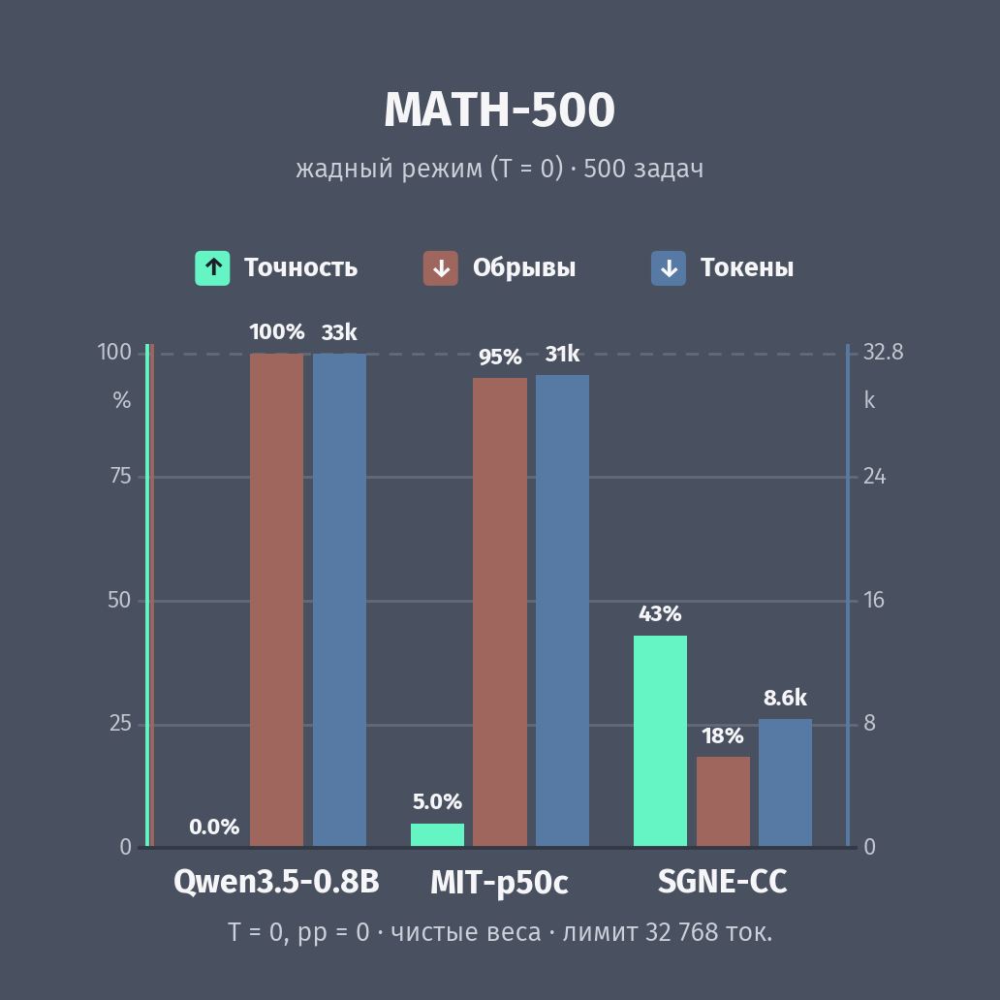
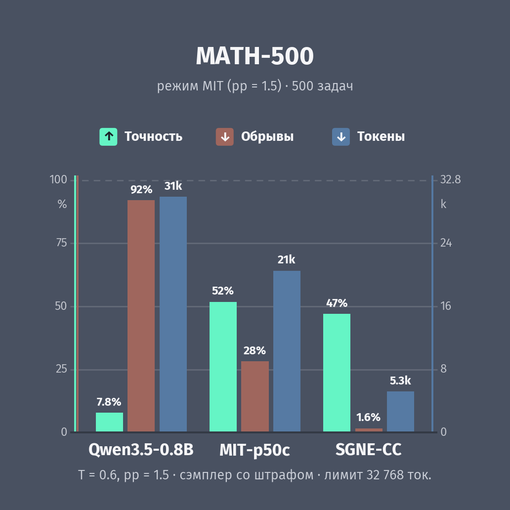
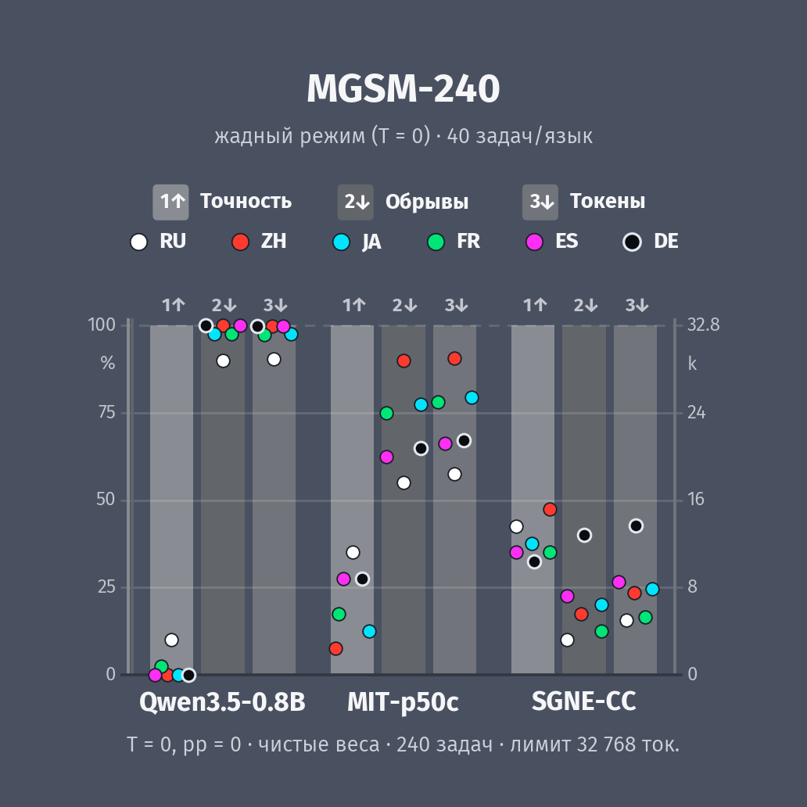
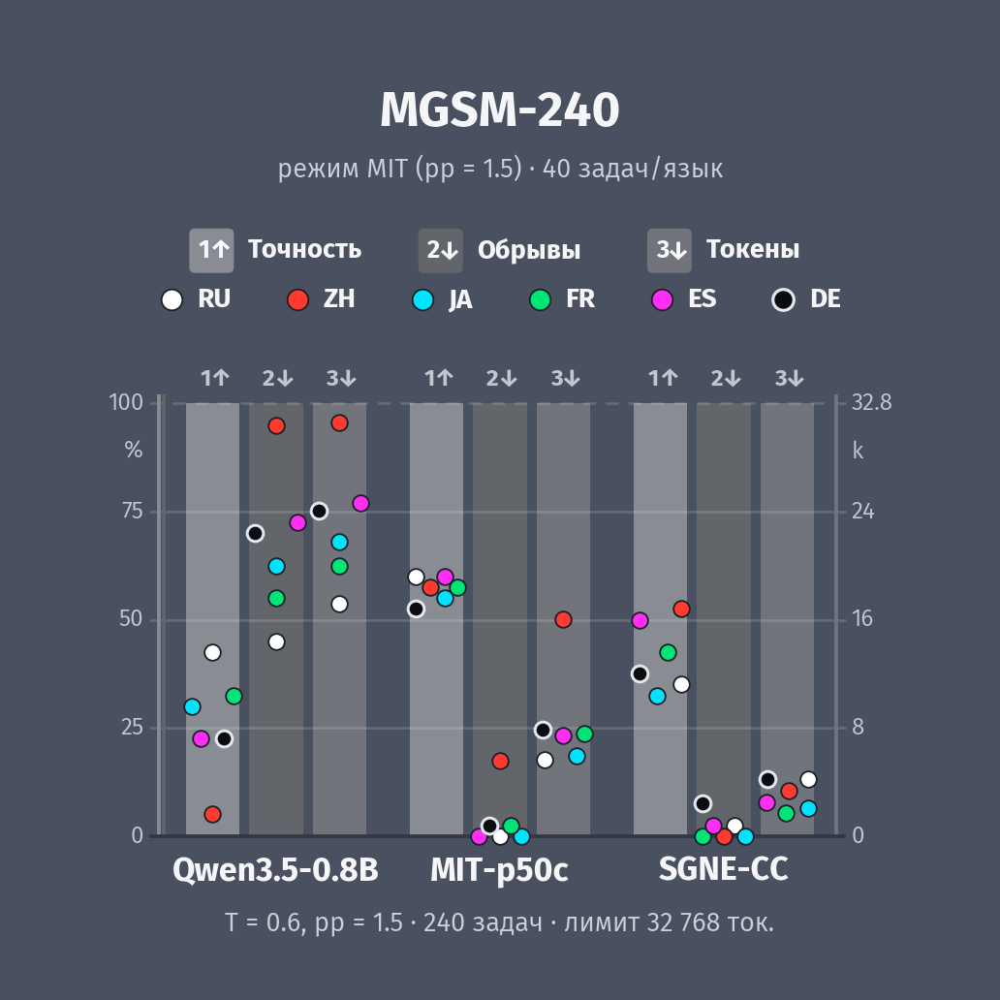
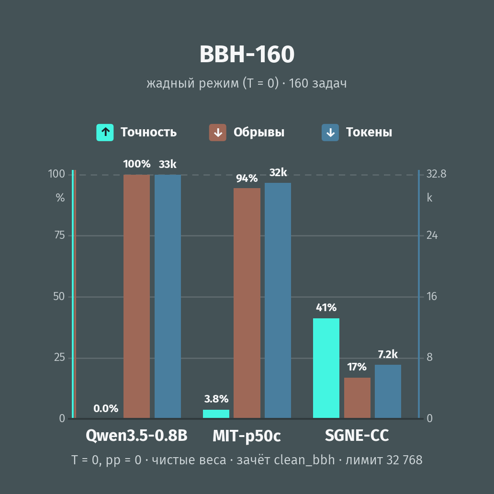
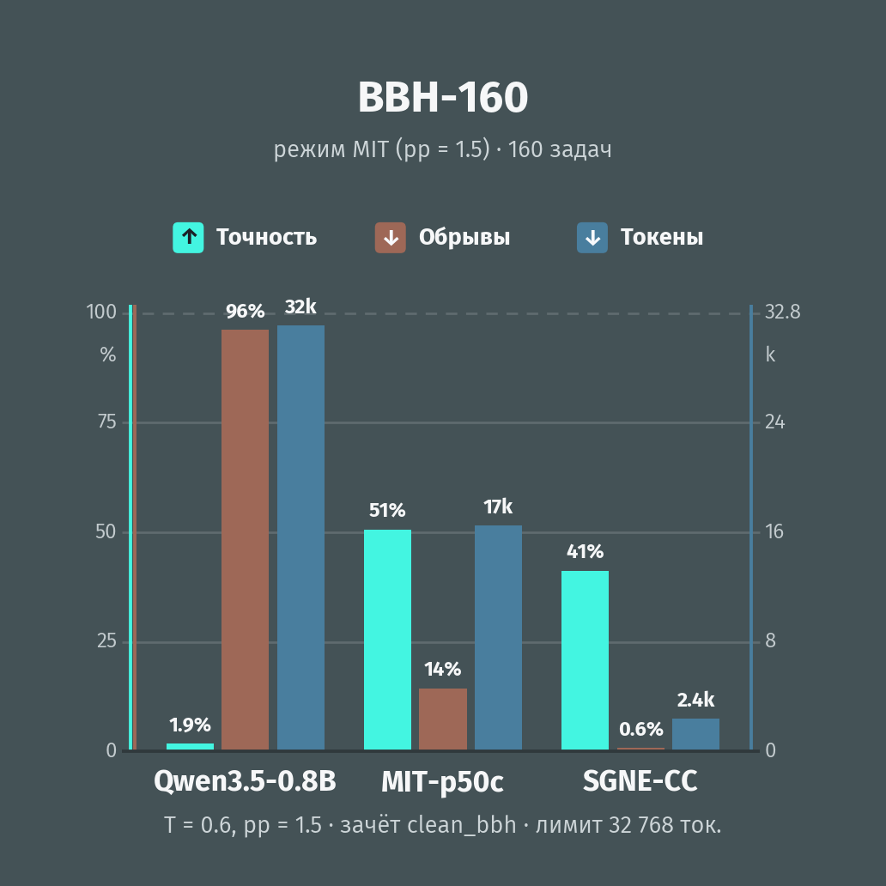
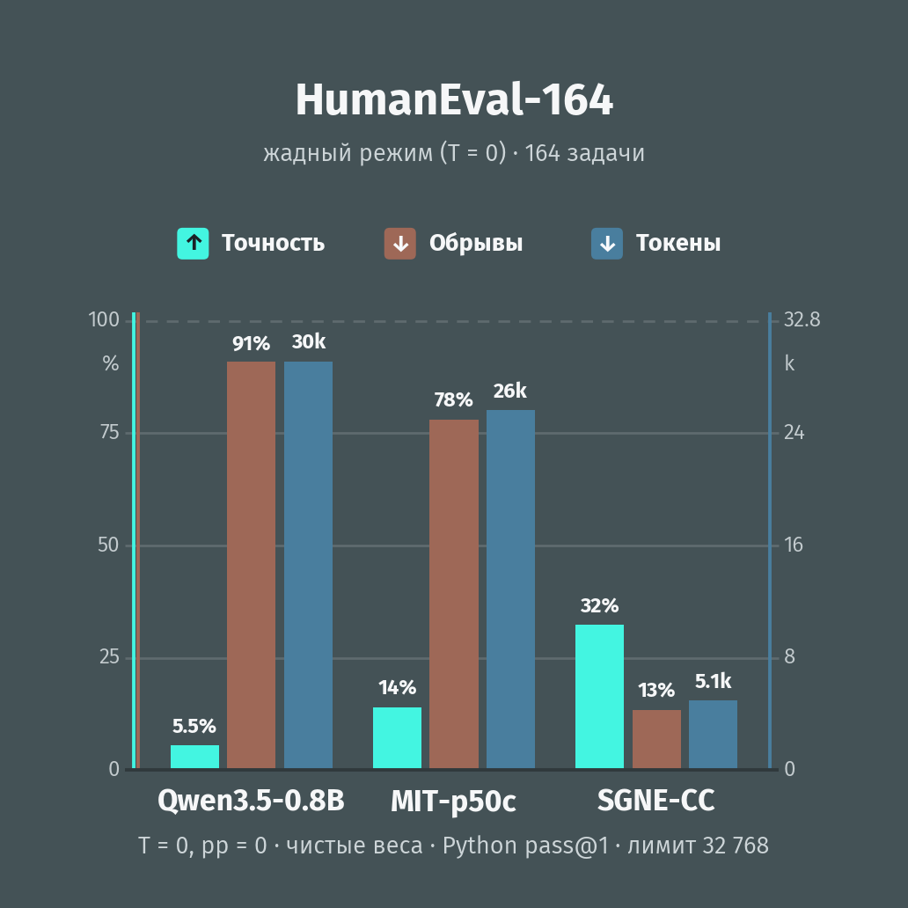
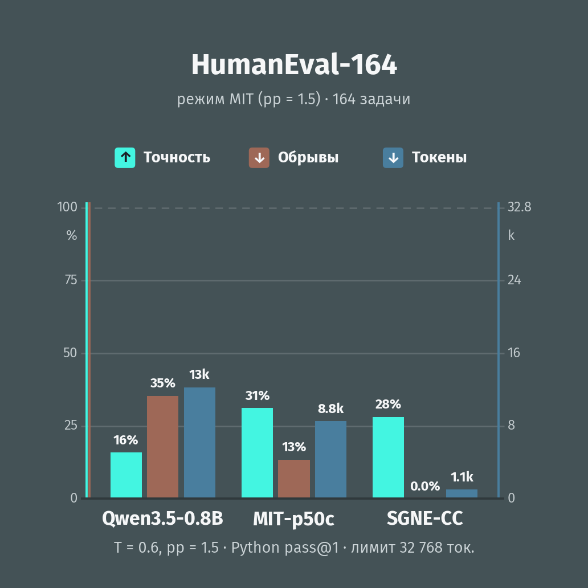
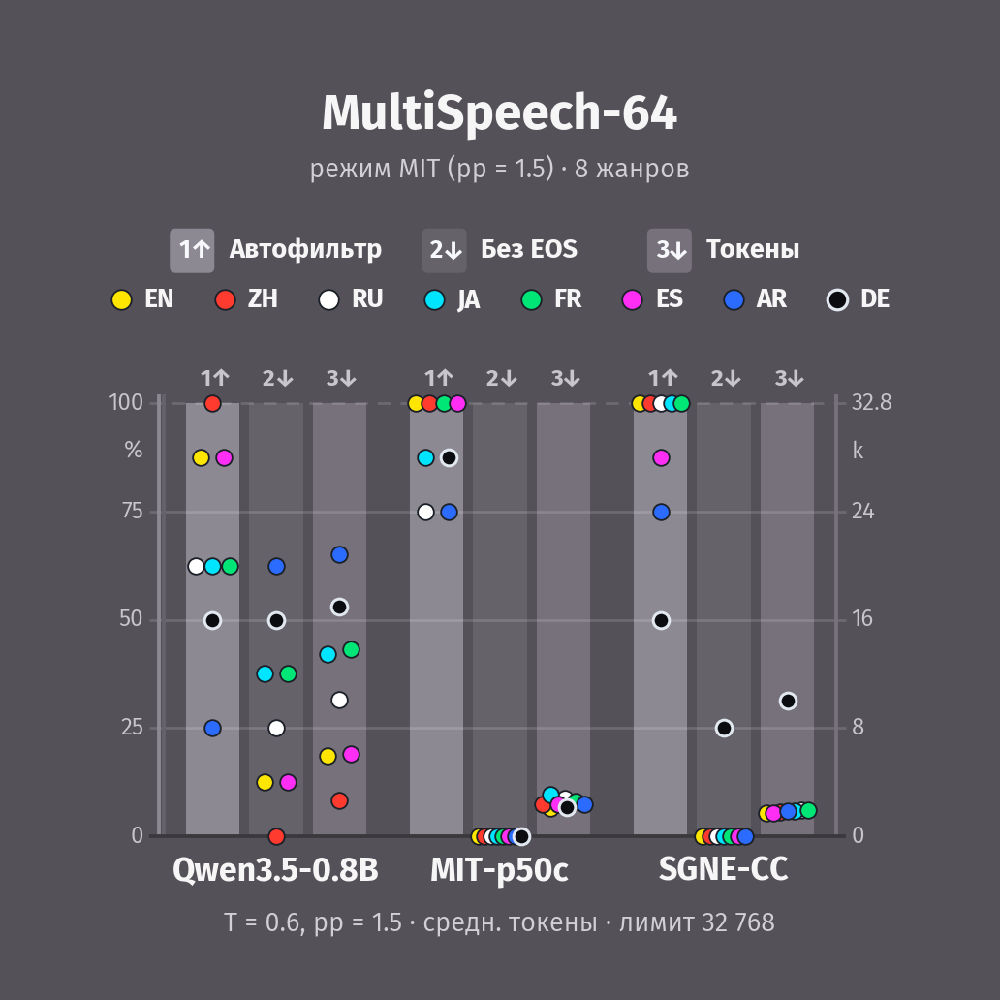

# Аудит весовой правки MIT-p50c и ДНК-редактирование весов (SGNE-CC) при лимите генерации 32 768 токенов

> **Language / Язык:** [English](README.md) · **Русский**

Qwen3.5-0.8B — гибридная модель с 752 млн параметров текстовой части, 18 рекуррентными слоями GatedDeltaNet и 6 слоями внимания. В проверенных прогонах с весами BF16 она часто не завершает размышление до установленного лимита в 32 768 новых токенов. В работе MIT CSAIL [*Sparks of Weight-Space Programming*](https://rikiyat.github.io/blog/weight-space-programming/) (Takehi, Teoh, Zhang, Khattab, 2026; журналы прогонов: [RikiyaT/lm_understand-logs](https://github.com/RikiyaT/lm_understand-logs)) прямая правка весов без дообучения MIT-p50c повышает точность на MATH-500 с 7.9% до 48.1% — в среднем по четырём прогонам vLLM в режиме карточки модели с температурой 0.6 и штрафом присутствия 1.5 за уже использованные токены. Базовая модель в этом эталоне достигает предела длины в 93.0% генераций. **Сохраняется ли сокращение зацикливания без случайного выбора токенов и штрафа присутствия? Какие различия в геометрии весов сопровождают изменение поведения?**

В настоящей работе проверяется геометрия весов MIT-p50c и сопоставляется альтернативная поправка объёмом 3.13 МиБ — **SGNE-CC** (*Spherical Gated Norm-preserving Edit, Column-Constrained* — сферическая весовая поправка с сохранением норм и рекуррентными воротами), полученная без градиентного дообучения поворотом выходных столбцов на сферах их исходной длины. Этот способ назван **ДНК-редактированием весов**. Три модели в формате BF16 (базовая Qwen3.5-0.8B, MIT-p50c и SGNE-CC) полностью пройдены в обоих режимах генерации — в **жадном режиме (чистые веса: T = 0, pp = 0)** и в **режиме карточки модели (T = 0.6, pp = 1.5)** — по всем пяти бенчмаркам (`MATH-500`, `MGSM-240`, `BBH-160`, `HumanEval-164`, `MultiSpeech-64`; 30 полных прогонов в режиме рассуждения по 1 128 заданий на модель в каждом режиме плюс контрольные прогоны без размышления на MultiSpeech-64).

---

## Содержание
1. [Геометрия весовых правок: MIT-p50c против SGNE-CC](#1-геометрия-весовых-правок-mit-p50c-против-sgne-cc)
2. [Сводная матрица 5 на 2 и математика (MATH-500 и MGSM-240)](#2-сводная-матрица-5-на-2-и-математика-math-500-и-mgsm-240)
3. [Перенос на логику и код (BBH-160, Web of Lies, HumanEval-164)](#3-перенос-на-логику-и-код-bbh-160-web-of-lies-humaneval-164)
4. [Генерация текстов на 8 языках (MultiSpeech-64)](#4-генерация-текстов-на-8-языках-multispeech-64)
5. [Границы метода, заключение и воспроизводимость (SHA-256)](#5-границы-метода-заключение-и-воспроизводимость-sha-256)

---

## 1. Геометрия весовых правок: MIT-p50c против SGNE-CC

Обе весовые поправки получены прямым изменением заводских весов Qwen/Qwen3.5-0.8B. Архитектура, токенизатор и программа исполнения модели остаются прежними; нумерация слоёв ниже начинается с нуля. Геометрические характеристики проверяются в двойной точности FP64 по открытому файлу поправки `sgne_cc_dna_delta.npz` (3.13 МиБ) и базовым весам командой `python3 apply_dna_patch.py --verify-only` (а при наличии чекпоинта MIT — бок о бок с флагом `--compare`):

| Проверяемый параметр весов (BF16) | Qwen3.5-0.8B | MIT-p50c | SGNE-CC (ДНК-редактирование) |
| :--- | :---: | :---: | :---: |
| Скалярных элементов в области замены (из 752 393 024) | 0 (0%) | 131 072 (0.017%; изменены 130 188) | 2 032 640 (0.270%; побитово изменены 1 993 382) |
| Выходных столбцов полносвязных блоков (`mlp.down_proj`) | 0 | 128 (2 слоя: индексы 15 и 19) | 802 (15 полносвязных слоёв) |
| Выходных столбцов рекуррентных блоков GatedDeltaNet (`out_proj`) | 0 | 0 (0 из 18 слоёв) | 1 182 (9 рекуррентных слоёв) |
| Выходных столбцов слоёв внимания (`o_proj`) | 0 | 0 | 0 (0 из 6 слоёв) |
| Строк рекуррентных ворот GatedDeltaNet (из 288) | 0 | 0 | **1** (слой 16, строка 12, косинус 0.986582) |
| Норма Фробениуса поправки по столбцам | 0.000000 | 2.239452 | 3.570648 (полная 3.574724) |
| Удельная энергия приращения на столбец | 0.0000 | 0.0392 | 0.0064 |
| Относительная норма поправки на выбранной области | 0.0000 | 0.7349 | 0.2372 (области разные: 128 против 1 984 столбцов) |
| Угол поворота столбца (медиана / максимум) | 0° | 27.1° / 87.3° | **8.8°** / 93.7° |
| Доля первой сингулярной моды (слои 15 / 19 / 23) | — | **99.9995% / 99.9991%** / — | **67.58% / 73.43% / 55.92%** |
| Диапазон отношения нормы столбца к исходной | 1.000000 | **[1.002808, 2.142614]** | **[0.998375, 1.001620]** |
| Максимальное отклонение нормы столбца | 0.0000% | **+114.2614%** (слой 19), **+70.5913%** (слой 15) | **0.1625%** (после округления в BF16) |
| Минимальный косинус поворота столбца | 1.000000 | 0.047701 (слой 19) | -0.063676 (слой 19, на сфере исходной длины) |

Между двумя правками есть три конструктивных различия:

1. **Направления и нормы столбцов.** В каждой из двух изменённых выходных матриц полносвязных блоков MIT-p50c (слои с индексами 15 и 19) на первую сингулярную моду приходится свыше 99.999% энергии приращения. Нормы отдельных столбцов при этом увеличены на величину до 114.3% — более чем вдвое относительно исходных. В SGNE-CC поворачиваются направления столбцов при сохранении исходных норм: максимальное измеренное отклонение после округления координат в BF16 составляет около 0.16%, медианный угол поворота равен 8.8°, максимальный — 93.7°. Сохранение норм отдельных столбцов само по себе не сохраняет взаимные углы между ними, величину выходных активаций и поведение модели.
2. **Распределение между полносвязными и рекуррентными блоками.** Три четверти глубины Qwen3.5-0.8B составляют рекуррентные слои GatedDeltaNet, которые в MIT-p50c остаются нетронутыми. В SGNE-CC многомерная поправка распределена между выходными матрицами 15 полносвязных и 9 рекуррентных слоёв; все 6 слоёв внимания оставлены без изменений.
3. **Изменение одной строки ворот затухания.** В 13-й из 16 голов слоя с индексом 16 изменена одна строка рекуррентных ворот: её евклидова норма сдвинута с 1.0286 до 1.0452. Поправка рассчитана на изменение удержания рекуррентного состояния при переходе от размышления к чистовому ответу; действует ли она избирательно именно на этой границе, требует отдельной проверки на активациях.

> **Рабочая гипотеза.** Цепи многошагового рассуждения уже сформированы в Qwen3.5-0.8B при предобучении, но удерживаются внутри цикла самопроверки: углы выходных столбцов меняют траекторию рассуждения, а устойчивость на горизонте 32 768 токенов связана с сохранением сферы исходных норм. Поскольку две правки различаются сразу по нескольким признакам — нормам столбцов, рангу поправки, набору слоёв, типам затронутых блоков и строке ворот в слое 16 — приведённые ниже результаты согласуются с этой гипотезой, но не доказывают причинный вклад сохранения норм отдельно от остальных факторов. Для прямой проверки нужны отдельные опыты, например приведение изменённых столбцов MIT-p50c к их исходной длине.

### Протокол генерации с лимитом 32 768 новых токенов
Для проверки чувствительности к настройкам декодирования модели оцениваются с включённым размышлением, одним прогоном на задачу, начальным зерном 0 и пределом 32 768 новых токенов (это лимит генерируемого ответа, а не позиционного окна модели в 262 144 токена). Настройки записаны в поле `sampling` основных файлов трасс, а для двух файлов отложенной проверки зафиксированы по протоколу автора в манифесте. Два режима одновременно различаются температурой, порогами отсечения и штрафом присутствия:
* **Жадный режим (чистые веса: T = 0, pp = 0)** — температура 0, top_p 1.0, top_k 0 без случайного выбора токенов и без штрафа присутствия: на каждом шаге выбирается наиболее вероятный токен. В отличие от заводского `generation_config.json` модели Qwen3.5-0.8B (где также заданы T = 0.6 и pp = 1.5), этот режим изолирует собственную динамику весов без внешнего сэмплера.
* **Режим карточки модели (T = 0.6, pp = 1.5)** — температура 0.6, пороги top_p 0.95 и top_k 20, штраф присутствия 1.5 за уже использованные токены: на каждом шаге из логита любого токена, уже встретившегося в сгенерированном ответе, однократно вычитается 1.5 независимо от числа повторов. Токены входного запроса в этот счётчик не входят.

Все десять срезов (5 наборов задач × 2 режима) по трём моделям (Qwen3.5-0.8B, MIT-p50c, SGNE-CC) сопровождаются полными позадачными трассами единого батчевого генератора на PyTorch с весами в BF16. По протоколу автора прогоны выполнены на ускорителях NVIDIA A100 и RTX PRO 6000 Blackwell в аппаратном BF16, а часть шардов — на NVIDIA T4 с матричными умножениями в FP16 и нормировками в FP32. В `traces/audit_bf16_vs_t4_parity60_pure_t0.json` дополнительно проверено численное расхождение BF16 (RTX PRO 6000 Blackwell / A100) против T4 FP16 на 60 трассах жадного режима (по 20 на модель): у базы совпадение зачёта 20/20 (0 против 0), у MIT-p50c — 19/20 (95%; 0 против 1), у SGNE-CC при одинаковой доле верных ответов (10/20 против 9/20) позадачное совпадение составило 13/20 (65%) из-за чувствительности длинных траекторий к пограничному округлению; привязка отдельных файлов трасс к конкретным ускорителям в самих `.jsonl` не записана и опирается на протокол автора.

Математические ответы проверяются символьно пакетом `math-verify`: строгий зачёт (`strict_ok`) требует закрытого размышления, штатного конца генерации и верного выражения в последней итоговой рамке; для MGSM предварительно убираются пробелы и разделители разрядов в записи целого числа. На графиках `MATH-500` (Рис. 1 и Рис. 2) приведены прямые сопоставимые прогоны всех трёх моделей на едином движке PyTorch, а внешний эталон vLLM из репозитория MIT для `T = 0.6, pp = 1.5` отдельно сопоставлен в тексте §2.2.

---

## 2. Сводная матрица 5 на 2 и математика (MATH-500 и MGSM-240)

Снятие штрафа присутствия и случайного сэмплирования (**жадный режим, T = 0, pp = 0**) радикально меняет соотношение правок. При отключении внешнего штрафа присутствия `-1.5` точность **MIT-p50c** падает на всех пяти наборах задач (в `2.2×–13.5×`), а доля обрывов на пределе 32 768 токенов взлетает с `17.29%` до `85.11%` по сумме 1 128 заданий. Сферическая правка с сохранением норм **SGNE-CC** в чистом жадном режиме опережает MIT-p50c на **всех пяти наборах (5 из 5)** по точности, частоте завершения и средней длине вывода. В то же время в режиме карточки модели (`T = 0.6, pp = 1.5`) SGNE-CC генерирует в `4.1×` короче (средняя длина по 1 128 заданиям `3 680.7` против `14 984.7` токенов, обрывы `1.42%` против `17.29%`), но уступает MIT-p50c по итоговой точности на `MATH-500`, `MGSM-240` и численно на `BBH-160` и `HumanEval-164`.

| Бенчмарк (число задач) | Режим генерации | Qwen3.5-0.8B (Точн. / Обрывы / Ток.) | MIT-p50c (Точн. / Обрывы / Ток.) | SGNE-CC (Точн. / Обрывы / Ток.) | Парный тест (SGNE-CC к MIT-p50c) |
| :--- | :--- | :---: | :---: | :---: | :--- |
| **MATH-500** (500) | Жадный (`T = 0, pp = 0`) | 0/500 (0.00%) · 100.0% · 32 768.0 | 25/500 (5.00%) · 95.00% · 31 350.5 | **215/500 (43.00%)** · **18.40%** · **8 558.0** | МакНемар `+195 / −5`, p = 3.24 × 10⁻⁵¹ |
| **MATH-500** (500) | Карточка (`T = 0.6, pp = 1.5`) | 39/500 (7.80%) · 92.20% · 30 632.6 | **259/500 (51.80%)** · 28.20% · 21 052.9 | 235/500 (47.00%) · **1.60%** · **5 319.4** | `+56 / −80`, p = 0.048 *(vs vLLM s0: +65/−71, p = 0.67)* |
| **MGSM-240** (240) | Жадный (`T = 0, pp = 0`) | 5/240 (2.08%) · 97.50% · 31 987.0 | 51/240 (21.25%) · 70.83% · 24 006.4 | **92/240 (38.33%)** · **20.42%** · **8 186.4** | `+54 / −13`, 40-блочный p = 1.67 × 10⁻⁶ |
| **MGSM-240** (240) | Карточка (`T = 0.6, pp = 1.5`) | 62/240 (25.83%) · 66.67% · 23 604.5 | **137/240 (57.08%)** · 3.75% · 8 625.3 | 100/240 (41.67%) · **2.08%** · **3 089.7** | `+15 / −52`, 40-блочный p = 9.04 × 10⁻⁵ |
| **BBH-160** (160) | Жадный (`T = 0, pp = 0`) | 0/160 (0.00%) · 100.0% · 32 768.0 | 6/160 (3.75%) · 94.38% · 31 670.9 | **66/160 (41.25%)** · **16.88%** · **7 249.2** | `+61 / −1`, p = 2.73 × 10⁻¹⁷ *(strict: 0 / 6 / 51)* |
| **BBH-160** (160) | Карточка (`T = 0.6, pp = 1.5`) | 3/160 (1.88%) · 96.25% · 31 850.6 | **81/160 (50.62%)** · 14.38% · 16 939.7 | 66/160 (41.25%) · **0.62%** · **2 446.0** | `+20 / −35`, p = 0.058 |
| **HumanEval-164** (164) | Жадный (`T = 0, pp = 0`) | 9/164 (5.49%) · 90.85% · 29 855.1 | 23/164 (14.02%) · 78.05% · 26 274.1 | **53/164 (32.32%)** · **13.41%** · **5 077.3** | `+37 / −7`, p = 5.30 × 10⁻⁶ *(`<think>`: 12.52×)* |
| **HumanEval-164** (164) | Карточка (`T = 0.6, pp = 1.5`) | 26/164 (15.85%) · 35.37% · 12 564.7 | **51/164 (31.10%)** · 13.41% · 8 751.8 | 46/164 (28.05%) · **0.00%** · **1 056.0** | `+13 / −18`, p = 0.473 *(`<think>`: 14.11×)* |
| **MultiSpeech-64** (64) | Жадный (`T = 0, pp = 0`) | 2/64 (3.12%) · 96.88% · 31 802.4 | 17/64 (26.56%) · 56.25% · 20 173.2 | **23/64 (35.94%)** · **34.38%** · **13 011.2** | `+11 / −5`, p = 0.210 |
| **MultiSpeech-64** (64) | Карточка (`T = 0.6, pp = 1.5`) | 43/64 (67.19%) · 29.69% · 11 508.3 | **58/64 (90.62%)** · **0.00%** · **2 509.2** | 57/64 (89.06%) · 3.12% · 2 910.1 | `+4 / −5`, p = 1.000 |
| **Итого по 5 наборам (1 128)** | **Жадный (`T = 0, pp = 0`)** | **16/1 128 (1.42%) · 97.96% · 32 123.7** | **122/1 128 (10.82%) · 85.11% · 28 461.1** | **449/1 128 (39.80%) · 18.79% · 8 039.9** | — |
| **Итого по 5 наборам (1 128)** | **Карточка (`T = 0.6, pp = 1.5`)** | **173/1 128 (15.34%) · 75.53% · 25 598.5** | **586/1 128 (51.95%) · 17.29% · 14 984.7** | **504/1 128 (44.68%) · 1.42% · 3 680.7** | — |

### 2.1. Полный MATH-500 в жадном режиме (чистые веса: T = 0, pp = 0)

**Рис. 1. При нулевой температуре и без штрафа присутствия SGNE-CC решает в 8.6 раза больше задач полного набора MATH-500, чем MIT-p50c.** *Все 500 задач MATH-500 в жадном режиме (`T = 0, pp = 0`), единый движок PyTorch, лимит 32 768 токенов. Строгий зачёт требует закрытого размышления, конца генерации и верного ответа в итоговой рамке.*

Без случайного сэмплера и штрафа присутствия базовая Qwen3.5-0.8B при строгом зачёте не решает ни одной задачи из 500 (0.00%, все 500 обрываются на 32 768 токенах), MIT-p50c решает 25 задач (5.00%, 475 обрывов, средняя длина 31 350.5 токена), а SGNE-CC — 215 задач (43.00%, 92 обрыва = 18.40%, средняя длина 8 558.0 токенов). Парный перевес SGNE-CC над MIT-p50c составляет +195/−5 задач (точный критерий МакНемара p = 3.24 × 10⁻⁵¹) при в 5.16 раза меньшем числе обрывов и в 3.66 раза более коротком ответе. Ещё в 25 задачах SGNE-CC штатно завершает генерацию до лимита без итоговой рамки `\boxed{}`.

Во многих задачах MIT-p50c рано получает верный промежуточный результат внутри размышления, но не переходит к ответу. В задаче о переводе декартовых координат в полярные (`precalculus/807`) MIT-p50c находит правильный ответ в начале рассуждения и затем 451 раз подряд повторяет абзац о проверке крайних случаев до предела в 32 768 токенов, оставляя чистовой ответ пустым. SGNE-CC записывает верный итоговый ответ в рамке и останавливается на 2 394 токенах (из них 1 944 в размышлении). Этот пример наглядно показывает разницу в завершении вывода, хотя один случай не объясняет все ошибки на наборе.

| Правило зачёта ответа на полном MATH-500 (500 задач, жадный режим T = 0, pp = 0) | Qwen3.5-0.8B | MIT-p50c | SGNE-CC | МакНемар (SGNE к MIT) |
| :--- | :---: | :---: | :---: | :---: |
| **Строгий зачёт** (закрытое размышление, конец генерации и верный ответ в рамке) | 0.00% (0/500) | 5.00% (25/500) | **43.00%** (215/500) | +195/−5, p = 3.24 × 10⁻⁵¹ |
| **Основное правило MIT** (штатное извлечение и символьная проверка без требования конца генерации) | 2.80% (14/500) | 6.40% (32/500) | **43.00%** (215/500) | +188/−5 |
| **Резервное правило MIT** (извлечение ответа из незавершённого размышления и символьная проверка) | 14.20% (71/500) | 18.60% (93/500) | **44.20%** (221/500) | — |

Даже резервное правило из репозитория MIT, извлекающее ответы из оборванного черновика на 32 768 токенах, даёт перевес SGNE-CC более чем вдвое (221 против 93 из 500). Архивная стратифицированная выборка из 100 задач семи разделов (`strat100`) при температуре 0 даёт согласованную картину: 0 / 4 / 44 в строгом зачёте (+41/−1, p = 1.96 × 10⁻¹¹), 1 / 5 / 44 по основному правилу MIT и 7 / 20 / 45 по резервному.

**Отложенная проверка после заморозки весов (`Holdout-300` и `FreshBlind-49`).** По протоколу исследования при подборе углов и отладке SGNE-CC использовались не более 200 задач MATH-500. Непересекающиеся списки 200 калибровочных и 300 нетронутых задач опубликованы в `suites/reproducibility_and_holdout_manifest.json` и проверяются программой `scripts/verify_paper_metrics.py`; в отсутствие внешней предрегистрации до релиза хронология заморозки опирается на протокол автора. На всех **300 нетронутых задачах** при температуре 0 база решает 0/300 (0.00%), MIT-p50c — 20/300 (6.67%, 93.33% обрывов, 30 850.5 токена), SGNE-CC — **154/300 (51.33%, 14.67% обрывов, 7 143.2 токена; +138/−4, p = 6.00 × 10⁻³⁶)**. В режиме карточки модели те же 300 задач дают 33/300 (11.00%), 180/300 (60.00%) и 165/300 (55.00%; +34/−49, p = 0.124). Из 300 нетронутых задач детерминированно по SHA-256 отобраны 49 задач (по 7 на раздел) и добавлены 7 длинных эссе объёмом 1 500–2 000 слов (`suites/fresh_blind56_32k_suite.json`): при температуре 0 SGNE-CC решает **24 из 49 (48.98%)** против 2/49 (4.08%) у MIT-p50c (+22/−0, p = 4.77 × 10⁻⁷) и 0/49 у базы (p = 1.19 × 10⁻⁷); в режиме карточки модели — 24/49 против 23/49 на PyTorch (+7/−6, p = 1.000) и 25/49 в первом внешнем прогоне vLLM (+8/−9, p = 1.000; среднее четырёх прогонов — 23.8). На семи эссе при температуре 0 SGNE-CC завершает размышление в 6 случаях из 7 и заканчивает генерацию до лимита в 2 из 7; база не завершает ни одного черновика (0 из 7).

### 2.2. Полный MATH-500 в режиме карточки модели (T = 0.6, pp = 1.5) и разбор уровней

**Рис. 2. В режиме карточки модели на едином движке PyTorch SGNE-CC уступает MIT-p50c по числу верных ответов, но генерирует вчетверо короче и почти не доходит до лимита длины.** *Все 500 задач MATH-500 при T = 0.6, pp = 1.5 на одном движке PyTorch BF16: 39, 259 и 235 решённых задач.*

Переход от жадного режима к режиму карточки модели (`T = 0.6, pp = 1.5`) резко меняет показатели MIT-p50c: в прямом прогоне на PyTorch по всем 500 задачам (`traces/math500_*_think32k_card_pp15.jsonl`) число верных ответов возрастает с 25 до **259 из 500 (51.80%)**, а обрывы на 32 768 токенах падают с 95.0% до 28.20%. Базовая модель решает 39 задач (7.80%, 92.20% обрывов, 30 632.6 токена), а SGNE-CC — **235 (47.00%, МакНемар +56/−80, номинальное p = 0.0482)**. При этом средняя длина ответа у SGNE-CC в 4.0 раза меньше (5 319.4 против 21 052.9 токена), а лимит генерации достигается в 17.6 раза реже (1.60% против 28.20%). Среди штатно завершённых ответов SGNE-CC в 62 случаях отсутствует итоговая рамка `\boxed{}`, и по строгому правилу они не засчитаны.

При сопоставлении с внешним эталоном MIT в vLLM из опубликованных журналов (первый прогон — 241 из 500 = 48.20%; среднее четырёх прогонов — 48.10%, 33.05% обрывов, 22 037.1 токена; независимый замер в карточке модели на H200 — 51.0% и 31.6% обрывов) статистически значимого различия между SGNE-CC и первым прогоном vLLM не выявлено (+65/−71, p = 0.6683), а ответы SGNE-CC короче среднего vLLM в 4.14 раза при в 20.7 раза меньшей доле обрывов. На 166 задачах с совпавшей извлечённой строкой ответа оценки опубликованного проверяющего скрипта и журналов MIT совпали полностью (166 из 166).

**Разбор по уровням трудности и разделам (`Level 1–2` и `Level 3–5`) в обоих режимах:**
* **Начальные уровни 1–2 (133 задачи).** В режиме карточки модели MIT-p50c решает 103 задачи (77.44%, обрывы 12.78%, 14 283.6 токена), SGNE-CC — 92 (69.17%, обрывы 0.75%, 2 566.5 токена; МакНемар +11/−22, p = 0.0801), база — 22 (16.54%, обрывы 83.46%, 28 124.3 токена). В **жадном режиме (`T = 0, pp = 0`)** картина меняется: без внешнего сэмплера **SGNE-CC вырастает до 95/133 (71.43%)** при 8.27% обрывов и 4 931.4 токена, тогда как MIT-p50c падает почти в 8 раз — до **13/133 (9.77%)** при 90.23% обрывов и 29 913.4 токена (+84/−2, p = 9.67 × 10⁻²³; у базы 0/133).
* **Старшие уровни 3–5 (367 задач).** В режиме карточки модели MIT-p50c решает 156 задач (42.51%, обрывы 33.79%, 23 506.1 токена), SGNE-CC — 143 (38.96%, обрывы 1.91%, 6 317.1 токена; +45/−58, номинальное p = 0.2369), база — 17 (4.63%). Внутри старших уровней в режиме карточки MIT-p50c ведёт в элементарной и школьной алгебре (96/142 = 67.6% против 77/142 = 54.2%; +14/−33, p = 0.0079), в теории чисел — 23/47 (48.9%) против 20/47 (42.6%; p = 0.65), а по сумме четырёх сложных разделов (углублённая алгебра, начала анализа, геометрия и комбинаторика с вероятностью) впереди SGNE-CC: 46/178 (25.8%) против 37/178 (20.8%; +23/−14, p = 0.1877). В **жадном режиме (`T = 0, pp = 0`)** SGNE-CC решает **120/367 (32.70%)** (70/142 в алгебре, 36/178 в четырёх сложных разделах, 14/47 в теории чисел) против **12/367 (3.27%)** у MIT-p50c (+111/−3, p = 2.38 × 10⁻²⁹) и 0/367 у базы.

### 2.3. Многоязычная текстовая арифметика (MGSM-240, 6 языков): оба режима

**Рис. 3. В жадном режиме на многоязычных сюжетных задачах MGSM-240 SGNE-CC опережает MIT-p50c по точности во всех шести языках.** *Сорок задач на шести языках (240 ответов при T = 0, pp = 0): 5, 51 и 92 верных ответа.*

**Рис. 4. В режиме карточки модели на MGSM-240 MIT-p50c возвращает лидерство по точности, тогда как SGNE-CC генерирует в 2.8 раза короче.** *Те же 240 ответов при T = 0.6, pp = 1.5: 62, 137 и 100 верных ответов. Поязыковые точки описательны и не образуют независимых выборок.*

На пакете MGSM-240 (одни и те же 40 школьных текстовых задач в переводах на русский, китайский, японский, французский, испанский и немецкий языки) сопоставление двух режимов особенно показательно:
* **Жадный режим (`T = 0, pp = 0`):** SGNE-CC решает **92 из 240 (38.33%, обрывы 20.42%, 8 186.4 токена)** против **51 из 240 (21.25%, обрывы 70.83%, 24 006.4 токена)** у MIT-p50c и **5 из 240 (2.08%, обрывы 97.50%, 31 987.0 токенов)** у базы. Расхождение пар равно +54/−13; точный кластерный знаковый тест по 40 шестиязычным блокам даёт двустороннее p = 1.67 × 10⁻⁶ (наивный критерий МакНемара: p = 4.47 × 10⁻⁷). На китайском языке при отключении `pp = 1.5` MIT-p50c падает с 23/40 (57.5%) до **3/40 (7.5%, 90.0% обрывов)**, тогда как SGNE-CC держит **19/40 (47.5%)**.
* **Режим карточки модели (`T = 0.6, pp = 1.5`):** MIT-p50c выходит вперёд со счётом **137 из 240 (57.08%, обрывы 3.75%, 8 625.3 токена)** против **100 из 240 (41.67%, обрывы 2.08%, 3 089.7 токена)** у SGNE-CC и **62 из 240 (25.83%, обрывы 66.67%, 23 604.5 токена)** у базы. Отставание SGNE-CC статистически значимо (пары +15/−52, точный 40-блочный кластерный тест p = 9.04 × 10⁻⁵; наивный МакНемар p = 6.46 × 10⁻⁶). На 52 записях, решённых MIT-p50c и нерешённых SGNE-CC, медианная длина ответа равна соответственно 5 364 и 1 934 токенам; встречаются буквальные ошибки разбора словесных сравнений и долей (`mgsm/ru/010, 014, 018, 024`, `mgsm/de/028, 038`, `mgsm/fr/011, 018`), а также арифметические сбои.

| Язык MGSM (40 задач на язык) | `T = 0, pp = 0` — База / MIT / SGNE (точн. %) | `T = 0, pp = 0` — Обрывы MIT / SGNE | `T = 0, pp = 0` — Токены MIT / SGNE |
| :--- | :---: | :---: | :---: |
| **RU** (русский) | 10.0% / 35.0% / **42.5%** | 55.0% / **10.0%** | 18.89 тыс. / **5.13 тыс.** |
| **ZH** (китайский) | 0.0% / 7.5% / **47.5%** | 90.0% / **17.5%** | 29.76 тыс. / **7.71 тыс.** |
| **JA** (японский) | 0.0% / 12.5% / **37.5%** | 77.5% / **20.0%** | 26.05 тыс. / **8.09 тыс.** |
| **FR** (французский) | 2.5% / 17.5% / **35.0%** | 75.0% / **12.5%** | 25.60 тыс. / **5.45 тыс.** |
| **ES** (испанский) | 0.0% / 27.5% / **35.0%** | 62.5% / **22.5%** | 21.75 тыс. / **8.74 тыс.** |
| **DE** (немецкий) | 0.0% / 27.5% / **32.5%** | 65.0% / **40.0%** | 21.99 тыс. / **14.00 тыс.** |

---

## 3. Перенос на логику и код (BBH-160, Web of Lies, HumanEval-164)

По протоколу исследования обе весовые поправки отбирались только на математических задачах: для MIT-p50c это описано в работе авторов MIT, а для SGNE-CC перечень калибровочных задач зафиксирован в `suites/reproducibility_and_holdout_manifest.json`. Проверки ниже оценивают перенос готовых моделей на символическую логику и генерацию кода на Python в обоих режимах декодирования.

### 3.1. Символическая логика (BBH-160 и Web of Lies)

**Рис. 5. В жадном режиме SGNE-CC удерживает ровно ту же логическую точность 41.3%, тогда как MIT-p50c обрушивается с 50.6% до 3.8%.** *Восемь подтестов BIG-Bench Hard по 20 задач (всего 160 задач при T = 0, pp = 0), нормализованная проверка `clean_bbh`.*

**Рис. 6. В режиме карточки модели на BBH-160 обе правки кратно превосходят базовую модель; SGNE-CC генерирует в 6.9 раза короче и почти не достигает лимита.** *Те же 160 задач при T = 0.6, pp = 1.5, нормализованная проверка `clean_bbh`.*

На пакете BBH-160 (**8 подтестов × 20 задач = 160 задач**) выявляется ключевое различие устойчивости двух правок:
* **Жадный режим (`T = 0, pp = 0`):** у SGNE-CC нормализованный зачёт (`clean_bbh`) равен **66 из 160 (41.25%, ровно 0.00 процентных пункта потери** относительно режима карточки; обрывы 16.88%, средняя длина 7 249.2 токена). MIT-p50c без штрафа присутствия падает более чем в 13 раз — до **6 из 160 (3.75%, 94.38% обрывов, 31 670.9 токена)**, база — 0 из 160 (0.00%, 100.0% обрывов, 32 768.0 токенов). Перевес SGNE-CC над MIT-p50c составляет +61/−1 задача (p = 2.73 × 10⁻¹⁷; по строгому числовому флагу `strict_ok` счёт равен 0 / 6 / 51).
* **Режим карточки модели (`T = 0.6, pp = 1.5`):** база решает 3 из 160 (1.88%), MIT-p50c — **81 (50.62%)**, SGNE-CC — **66 (41.25%)**. Различие между двумя правками не переходит порог 0.05 (+20/−35, p = 0.0581), тогда как средняя длина ответа у SGNE-CC меньше в 6.93 раза (2 446.0 против 16 939.7 токена), а доля обрывов на лимите — в 23 раза (0.62%, или 1 ответ, против 14.38%, или 23 ответов у MIT-p50c и 154 у базы; сохранённый флаг `strict_ok` равен 1 / 66 / 54, +19/−31, p = 0.1189).
* **Подтест цепочек истины и лжи (`Web of Lies`, 20 задач внутри `BBH-160`).** В жадном режиме (`T = 0, pp = 0`) и база, и MIT-p50c дают 0 из 20 (100% обрывов на 32 768 токенах), тогда как SGNE-CC решает **7 из 20 (35.0%, 15.0% обрывов, 6 485.5 токена; +7/−0, p = 0.0156)**. В режиме карточки (`T = 0.6, pp = 1.5`) SGNE-CC завершает все 20 ответов до лимита со счётом **9 из 20 (45.0%, 1 844 токена)** против 7 из 20 у MIT-p50c (35.0%, 4 обрыва, 19 250 токенов; +4/−2, p = 0.6875) и 0 из 20 у базы (+9/−0, p = 0.0039); в оборванных ответах MIT-p50c вроде `bbh/web_of_lies/000` зацикливание происходит уже после закрытия размышления на 18 833-м токене.

### 3.2. Генерация кода на Python (HumanEval-164, модульные тесты)

**Рис. 7. В жадном режиме без шума сэмплера SGNE-CC ставит лучший результат всей серии — 32.3% (53 из 164) при сжатии размышления в 12.5 раза.** *Полный набор HumanEval из 164 задач при T = 0, pp = 0, модульные тесты в изолированной песочнице.*

**Рис. 8. В режиме карточки модели на HumanEval-164 SGNE-CC сокращает размышление в 14.1 раза и завершает 100% ответов, уступая MIT-p50c на 5 задач (p = 0.47).** *Те же 164 задачи при T = 0.6, pp = 1.5, архивный прогон модульных тестов.*

На написании кода на Python (`HumanEval-164`) убрав случайный шум и штраф присутствия, **SGNE-CC достигает своего лучшего абсолютного результата во всей серии**:
* **Жадный режим (`T = 0, pp = 0`):** SGNE-CC проходит **53 из 164 тестов (`32.32%` `pass@1`)** — выше не только жадных показателей базы (`9/164 = 5.49%`, обрывы 90.85%, 29 855.1 токена) и MIT-p50c (`23/164 = 14.02%`, обрывы 78.05%, 26 274.1 токена), но и результата MIT-p50c в режиме карточки (`51/164 = 31.10%`). Внутри жадного режима преимущество SGNE-CC высокозначимо как над MIT-p50c (+37/−7, p = 5.30 × 10⁻⁶), так и над базовой моделью (+47/−3, p = 3.71 × 10⁻¹¹). Средняя длина блока размышления `<think>` у SGNE-CC сжимается в **12.52 раза** (1 767.9 против 22 129.0 токенов у MIT-p50c и 29 641.3 у базы), общая длина — 5 077.3 токена (13.41% обрывов). Из 164 ответов SGNE-CC код функции извлекается в 157 случаях, 154 проходят разбор `ast.parse`; распределение отказов по статусам: `PASS = 53`, `ASSERTION_FAIL = 92`, `RUNTIME_ERROR = 9`, `UNCLOSED_THINK_32K = 7`, `SYNTAX_ERROR = 3` (против `105` незакрытых `<think>` у MIT-p50c и `148` у базы; у MIT-p50c извлечено 59, синтаксически корректны 51).
* **Режим карточки модели (`T = 0.6, pp = 1.5`):** по архивному отчёту тестов (сводка в `suites/reproducibility_and_holdout_manifest.json`, воспроизводится в контейнере скриптом `scripts/grade_humaneval_sandbox.py`) база проходит 26 из 164 (15.85%, 35.37% обрывов, 12 564.7 токена), MIT-p50c — 51 (31.10%, 13.41% обрывов, 8 751.8 токена), SGNE-CC — 46 (28.05%, 0.00% обрывов, 1 056.0 токена). Различие между правками статистически не значимо (МакНемар +13/−18, p = 0.4731); обе правки значимо выше базы (p ≤ 0.0029). Размышление SGNE-CC короче в **14.11 раза** (448.8 против 6 334.3 токена). Код извлекается во всех 164 ответах SGNE-CC, 158 проходят `ast.parse` (отказы: `AssertionError` — 81, `RuntimeError` — 28, `SyntaxError` — 7, таймаут — 2). У MIT-p50c при `pp = 1.5` в восьми незавершённых ответах всё равно возникают многотысячные серии одного символа до 32 768 — пробелов (`HumanEval/24`, `HumanEval/159`), скобок `')))))...'` (`HumanEval/61`) или девяток `'99999...'` (`HumanEval/144`).

---

## 4. Генерация текстов на 8 языках (MultiSpeech-64)

Набор MultiSpeech-64 включает 8 прикладных жанров на 8 языках (русском, английском, китайском, немецком, испанском, французском, японском и арабском) — всего 768 ответов трёх моделей в четырёх режимах (два с размышлением при 32 768 токенах и два контрольных без размышления при 4 096 токенах). Автоматический фильтр засчитывает ответ, если одновременно закрыто размышление, достигнут конец генерации, чистовой текст непуст, доля повторяющихся восьмисимвольных цепочек не превышает 25% (а для языков с пробелами доля повторяющихся четвёрок слов — не выше 20%) и проверка не выявляет вставок чужой письменности. Такой фильтр проверяет **формальную устойчивость генерации**, но не смысловую связность, фактическую точность и следование запросу — содержательные сбои разобраны ниже отдельно. На каждый язык приходится по 8 заданий, поэтому поязыковые срезы носят описательный характер.

### 4.1. Жадный режим (чистые веса: T = 0, pp = 0)

**Рис. 9. При нулевой температуре обе правки повышают долю формально завершённых текстов относительно базы, причём SGNE-CC вдвое реже не закрывает размышление, чем MIT-p50c.** *Восемь языков по восемь жанров без случайного выбора токенов и штрафа присутствия; автофильтр проходят 2, 17 и 23 ответа из 64.*

Без случайного выбора токенов и штрафа присутствия обе правки кратно превосходят базовую модель по доле прохождения автофильтра (p < 10⁻⁴): база проходит 2 задания из 64 (3.1%), MIT-p50c — 17 (26.6%), SGNE-CC — 23 (35.9%; МакНемар +11/−5, p = 0.210). Полностью нулевой результат на языке (0 из 8) базовая модель получает на шести языках из восьми, MIT-p50c — на двух (японском и арабском), SGNE-CC — на одном (немецком). Численно SGNE-CC выше на пяти языках (английском, китайском, испанском, японском и арабском), равна MIT-p50c на французском и ниже на русском и немецком. Характер отказов у трёх моделей различается:
* **Базовая Qwen3.5-0.8B остаётся внутри размышления.** В 60 заданиях из 64 чистовой ответ пуст: все 32 768 токенов уходят на внутренний черновик, а до конца генерации модель доходит лишь дважды.
* **MIT-p50c завершает размышление, но зацикливается в чистовом ответе.** Размышление не закрыто в 22 случаях из 64 (конец генерации достигнут в 28), однако без штрафа присутствия модель начинает повторять строки уже в видимом тексте: в арабском деловом письме (`ar/formal_letter`) раздувает шапку анкеты `**الاسم:** [الاسم الكامل]` до 68.5 тыс. знаков, в английском научно-популярном тексте (`en/pop_science`) повторяет абзац на 134.2 тыс. знаков, а в китайской справке (`zh/structured_brief`) повторяет слово `扶手、扶手...` («подлокотник») до предела длины.
* **SGNE-CC реже оставляет незакрытое размышление:** 5 случаев против 22 у MIT-p50c (в 4.4 раза меньше; всего пустых чистовых ответов 6), а до конца генерации доходят 42 ответа из 64. На трёх перечисленных выше заданиях SGNE-CC выдаёт компактные завершённые тексты; медианная длина по всему набору равна 2 235 токенам против 32 768 у MIT-p50c (средняя — 13 011.2 против 20 173.2). При этом у SGNE-CC выше частота парных звёздочек (16.53 против 5.55 на 1 000 знаков, включая обычное выделение шрифта в Markdown) и сохраняются повторы на немецком языке; на русском историческом портрете (`ru/historical_portrait`) при нулевой температуре размышление не завершают все три модели.

### 4.2. Режим карточки модели (T = 0.6, pp = 1.5): повторы, иноязычные вставки и искажения фактов

**Рис. 10. В режиме карточки модели обе правки закрывают размышление во всех заданиях, но сохраняют отдельные повторы и вставки чужой письменности.** *Автофильтр проходят 43, 58 и 57 ответов из 64; формальный фильтр не проверяет достоверность фактов.*

В режиме карточки модели ни MIT-p50c, ни SGNE-CC не оставляют незавершённых размышлений (0 из 64 против 13 из 64 у базы). По формальному фильтру различия между двумя правками не выявлено (58 из 64 против 57 из 64, p = 1.000), и обе значимо превышают результат базы (43 из 64, номинальное p < 0.005). Медиана длины у SGNE-CC ниже (1 861 против 2 311 токенов), а среднее выше (2 910.1 против 2 509.2 токена) из-за двух немецких ответов, дошедших до предела 32 768. В контрольных прогонах с отключённым размышлением при лимите 4 096 токенов значимых различий между тремя моделями не обнаружено: 29 / 31 / 33 из 64 в жадном режиме (p ≥ 0.48 во всех парах) и 61 / 61 / 59 из 64 в режиме карточки (p ≥ 0.625), однако эти контроли ограничены 64 заданиями и формальным фильтром.

**Содержательные ограничения.** Во-первых, в режиме карточки модели у MIT-p50c встретились три ответа со вставками китайских иероглифов внутрь русских и арабских слов («сохранять стабильную航速 при низких температурах», `يحقق双赢`, `| المهمة |责任人 |`), а у SGNE-CC — два случая на арабском (`نصف的量`, `قواعد定期`) без сбоев на русском (8 из 8). Вызваны ли такие вставки напрямую штрафом присутствия, можно проверить только отдельным опытом с изменением одного этого параметра. Во-вторых, четыре из пяти оставшихся превышений порога повторов у SGNE-CC приходятся на немецкий язык (4 из 8, ещё одно — на испанский); связь этого сбоя с немецким словосложением остаётся непроверенной гипотезой. В-третьих, в задании `ru/historical_portrait` имя Фритьофа Нансена прямо названо в запросе, но SGNE-CC заменяет его в тексте словами «флот-командир **Ф. 1895**» и штатно завершает генерацию, проходя автофильтр. Этот случай показывает, что формальное завершение ответа не гарантирует ни соблюдения инструкции, ни сохранности фактов из запроса.

---

## 5. Границы метода, заключение и воспроизводимость (SHA-256)

### Что показывает и чего не показывает ДНК-редактирование весов
1. **Наблюдаемое поведение.** Готовая весовая поправка SGNE-CC кратно сокращает длину генерации и долю достижения лимита в 32 768 токенов на всех пяти проверенных наборах (`MATH-500`, `MGSM-240`, `BBH-160`, `HumanEval-164`, `MultiSpeech-64`) в обоих режимах. В жадном режиме без случайного сэмплера и штрафа присутствия (`T = 0, pp = 0`) SGNE-CC превосходит MIT-p50c и базовую модель на всех 5 из 5 наборов (`39.80%` против `10.82%` и `1.42%` по сумме 1 128 заданий), а на `HumanEval-164` ставит лучший результат всей серии (`32.32%`). Причинный вклад сохранения норм столбцов отдельно от остальных параметров правки и её влияние на запас знаний модели этими сравнениями не установлены.
2. **Соотношение длины и точности.** Итог по точности зависит от класса задач и режима генерации. Без внешнего штрафа присутствия (`T = 0, pp = 0`) MIT-p50c теряет большую часть прироста, тогда как SGNE-CC сохраняет устойчивость (например, ровно `41.25%` на `BBH-160` в обоих режимах и `71.43%` на уровнях 1–2 `MATH-500`). Напротив, в режиме карточки модели (`T = 0.6, pp = 1.5`) MIT-p50c значительно обгоняет SGNE-CC на многоязычных сюжетных задачах `MGSM-240` (`57.08%` против `41.67%`) и набирает больше верных ответов в прямом прогоне на PyTorch на полном `MATH-500` (`51.80%` против `47.00%`) и численно на `BBH-160` (`50.62%` против `41.25%`) и `HumanEval-164` (`31.10%` против `28.05%`). Оба режима нужно рассматривать раздельно, не сводя результаты к утверждению «короче без потерь».
3. **Независимая проверка артефакта.** Процедура поиска углов поворота не публикуется, тогда как сама весовая поправка в BF16 (`sgne_cc_dna_delta.npz`), манифест разбиения, все 8 наборов заданий, 38 файлов трасс, 3 файла официальных эталонов MIT и файл сверки BF16/T4-FP16 (всего **52 файла под контрольными суммами SHA-256**) полностью открыты. Геометрия весов и все показатели по сохранённым трассам пересчитываются локально на процессоре; повторная генерация на ускорителях и изолированный запуск сгенерированного кода остаются отдельными шагами.

### Ограничения протокола
* **Один прогон на задачу.** Во всех прямых прогонах на PyTorch записан один ответ на задачу (зерно 0), поэтому разброс между запусками внутри генератора на PyTorch не оценивался; для внешнего эталона MIT на полном MATH-500 в режиме карточки доступны четыре запуска vLLM.
* **Аппаратный протокол, численная точность и статистика.** Прямые трассы получены общим батчевым генератором на нескольких ускорителях: по протоколу автора — NVIDIA A100 и RTX PRO 6000 Blackwell в аппаратном BF16 и часть шардов на NVIDIA T4 с умножениями в FP16 и нормировками в FP32. В открытом файле `traces/audit_bf16_vs_t4_parity60_pure_t0.json` зафиксирована прямая сверка 60 трасс `T = 0` между нативным BF16 и T4 FP16 (по 20 задач на модель): базовая модель совпала 20/20 (0 против 0 на RTX PRO 6000 Blackwell), MIT-p50c — 19/20 (0 против 1 на A100-SXM4-40GB), SGNE-CC — 13/20 (65%) позадачного совпадения при близком итоговом счёте 10/20 против 9/20 на RTX PRO 6000 Blackwell. Доступные параметры генерации, шаблоны запросов и численные режимы задокументированы в `suites/reproducibility_and_holdout_manifest.json`, тогда как привязка отдельных файлов трасс к конкретным картам в самих `.jsonl` не записана. Независимый перепрогон при нулевой температуре в vLLM остаётся полезной внешней проверкой. Все значения p в подвыборках и предметных срезах номинальные, без поправки на множественные сравнения; значение p > 0.05 означает невыявленное различие на данном объёме выборки, а не доказательство равенства моделей.
* **Безопасность запуска сгенерированного кода.** Программа `scripts/grade_humaneval_sandbox.py` выполняет написанный моделью код на Python от имени текущего пользователя (флаг `python -I` изолирует только пути импорта интерпретатора, а не файловую систему или сеть). Запускать её следует только внутри одноразового контейнера или виртуальной машины.

### Заключение
Сравнение готовых весовых правок во всей матрице 5 × 2 показывает, что различия в геометрии весов сопровождаются резким расхождением устойчивости без помощи внешнего сэмплера. В режиме карточки модели штраф присутствия выводит MIT-p50c из зацикливания и обеспечивает более высокую точность на текстовой арифметике MGSM-240 и полном MATH-500, однако при снятии этого штрафа (`T = 0, pp = 0`) результат MIT-p50c обрушивается в 2.2–13.5 раза, тогда как SGNE-CC сохраняет работоспособность на всех пяти наборах и ставит рекорд серии на HumanEval-164. Причинная роль сохранения норм отдельно от набора слоёв, ранга поправки и строки ворот в слое 16 требует изолированных экспериментов, а формально завершённый текст у обеих правок может содержать искажения фактов или повторы на отдельных языках. Открытые патч и 38 файлов трасс позволяют полностью проверить геометрию артефакта и все измерения локально.

### Контрольные суммы артефактов (SHA-256), лицензия и локальная проверка
* Архивная копия на Zenodo (двуязычная статья, поправка `sgne_cc_dna_delta.npz` и полный архив репозитория): [DOI 10.5281/zenodo.24235218](https://doi.org/10.5281/zenodo.24235218).
* Авторский код, файл весовой поправки и текст статьи открыты под лицензией **Apache-2.0** ([`LICENSE`](LICENSE)). Включённые сторонние программы, наборы задач и журналы сохраняют исходные лицензии; перечень источников и уведомлений приведён в [`NOTICE`](NOTICE) и [`THIRD_PARTY_LICENSES.md`](THIRD_PARTY_LICENSES.md).
* Базовая модель: Qwen/Qwen3.5-0.8B (752 393 024 параметра текстовой части, BF16). Проверенные файлы: `model.safetensors` — `04b1c301231dd422b8860db31311ab2721511346a32cb1e079c4c4e5f1fe4696`; `config.json` — `b90b86f35c8e6925ef74ee04d0e758f0a845c83a42089ad82bbaa948de9b4204`; `tokenizer.json` — `5f9e4d4901a92b997e463c1f46055088b6cca5ca61a6522d1b9f64c4bb81cb42`.
* Весовая поправка SGNE-CC (`sgne_cc_dna_delta.npz`, 3.13 МиБ, изменённые столбцы и строка ворот в BF16): `4e4d36e032869bc10f56e2a2033a52d3f2774321cf867ef6f74274a7c0d1566d`.
* Чекпоинт сравнения MIT-p50c: распространяется авторами MIT отдельно на Hugging Face ([RikiyaT/Qwen3.5-0.8B-weight-space-programming](https://huggingface.co/RikiyaT/Qwen3.5-0.8B-weight-space-programming)) и поддерживается флагом `--compare` в `apply_dna_patch.py`.
* Манифест и пакеты задач (`suites/*.json`, 9 файлов):
  * `reproducibility_and_holdout_manifest.json`: `c36bd257d55e7643f0c10378fdd935f184e1740630b7c0a05f42f48cea01689a`
  * `fresh_blind56_32k_suite.json`: `63ba2cf247934afbc767865a5727eb403bbbc6af3205d44d3e755fe849a43e89`
  * `suite_math500_full.json`: `a596fa9b05b35f2c0ff32b70ea620d3241d90862cbd9bd1e77af738bb5c78a9b`
  * `suite_math500_strat100.json`: `6347b75c46d4969a1c021ff8d42ba80e3c5c1a00540e62b7dc6fd0b8a8dd0c79`
  * `suite_mgsm240.json`: `07fc6f003fb91dbffac881f825bbb1636d7b9509c6d3fb928aeb9fc0edda32d5`
  * `suite_bbh160.json`: `d39a779dd69e915e4dd995d19be973e4108b4039e9721b5d1620493838db001c`
  * `suite_unseen_humaneval164.json`: `5703edc81a78f82dca58da583036dd73e22715085ca99540c8d88189f19e1a89`
  * `suite_unseen_mgsm240_bbh160.json`: `5de44113cae2b07d8a693d1c87a2e61de5a18d79dd9c01e1049b10453f41df66`
  * `suite_multispeech64.json`: `8fa2da6c2ab8bd7d64659c24b1ead845032f19db6a3c79e05790a4d30afabe55`
* Трассы `MATH-500` (500 задач, жадный `T = 0, pp = 0` — база / MIT / SGNE): `97e2b70bbe81367254a972b7efd4b0c649a35c6f08ae0fb992bc1c545c936a4f` / `ea51d00c88bf65a26acd82a977290ae0b5392eddfb8b18abb18826f773b6a8c8` / `4b94c6c55599f40f26973af412b513b519d5d6232ebf374b16137089c7f4baf4`
* Трассы `MATH-500` (500 задач, карточка `T = 0.6, pp = 1.5` — база / MIT / SGNE): `6d06d373c429c760584a553ebf9ed26a639f42ee64b4ce72b86d0c49fc3c113c` / `2c766bf006030cb15dd6d8256534ca6ad730b8a780d9c058872d09d9b150ffb6` / `8f4fed10df896a6ffe5f367982f23d88625cdee1b3cba5a40801626ce3b7be9a`
* Внешний эталон MIT vLLM (`traces/mit_official_math500_ref/`: `mit_p50c_merged.json` / `mit_p50c_official_500_per_problem.json` / `mit_unedited_merged.json`): `c93d3db30a612ef0da396014fdfbe011efbcf2cd417e2e6125664d7effdd0471` / `a699f8b5e31c8db138f5137ceba736fa26275630fdac803ba824ba1b1bad3edf` / `5c31370485b9f197f592745e935eeaee6b09dc127daa5b2a8be1ebbcbc210221`
* Архивные выборки `MATH-500` `strat100` (T = 0 — база / MIT / SGNE): `8df959b204995ca909f68533c1bb857f4e9a2a04789cf9dc27b8bb46fede68fd` / `4634cb4a5234cfce5627d8b31b6e103d28ebac009735e5c3475b6ac7913aeb26` / `bf1a30e67cf900fbb892c5b4ac6ed7220fc64d8ef2e87e29ec6b6fa69187f350`; отложенные трассы `blind56` (база / SGNE): `58d0db19f5d3d95dea9e4cb39b9a66979cfaef01a5235be8ed4b9945b1064ec0` / `2072450af148d124fb09f9698d9eb137b933f44014f125e91f394709d7e5a14e`
* Трассы `MGSM-240` (жадный `T = 0` — база / MIT / SGNE): `d0f05df915c4f9d501a7d0cf4e6062d164791c59d2de84c422b5280df11477ae` / `8f05359ab873100db2e083e5600b5fdced7df25b005c9a0a4cc0a490132afa5a` / `7aab88c558d2550bf848c8f0cf81d5033a1ae9c7de1b85db16d4eb611d880690`
* Трассы `BBH-160` (жадный `T = 0` — база / MIT / SGNE): `ab9852c54587a7196a7c155b8626348b6bddaf4bcef72546b7f32347c50963d7` / `7ef1b9c7159a2b3798f7ac93943a6d8eba1a0d21d2cbca4e90b92efab33129c8` / `658bf3a2c313ca693117a1d8e63e1f635e6f45e7258f0d561c83bee4f1699cf8`
* Объединённые трассы `MGSM-240 + BBH-160` (карточка `T = 0.6, pp = 1.5` — база / MIT / SGNE): `8e7fa9ece63a7de7399b786dc53df8a1c1287e049bbea25e612a836c996fe23e` / `317556c3dd0e42b2561c37cd36d82e847a3fa2884523508e02348b0f9c96ba64` / `a8936581d18a482b773ad40f71cd6bfc59e93a5bc57280b44e3d30a963a93767`
* Трассы `HumanEval-164` (жадный `T = 0` — база / MIT / SGNE): `a9b1aba270fc6f53be031749248e269c85d32302540e129419997eb30b0c72b5` / `038bd14e53ccfdffb4a25aa59da8769306ddd49036b5f415398c040cda51cd3c` / `f8f40e0640f1b5bacca883a063da1b40627560efb5e7f898000ee067af314322`
* Трассы `HumanEval-164` (карточка `T = 0.6, pp = 1.5` — база / MIT / SGNE): `b2fd764fe9f681567a0d35a3251f484f9969c9149b63044589773e178369b041` / `dd1c6ea407d53ce0a4b9e22f5ec9436c2984419b074ac847c273293b1f0c4a13` / `fc67fef2e2db445be97d94c6ac23981b848f557d10e981a0d043a06767c42106`
* Трассы `MultiSpeech-64` (жадный `T = 0` с размышлением — база / MIT / SGNE): `13fece99c98ae619687cf71970b45d52b326d751a536d2ce678b56cd4e6c994d` / `a2574d87d70ec5da102be1be12dd8c2de7c7fdfa29fa6a523be1ed863422408d` / `f9f27c9b36c53b4605b5d57eb2d6aa81f4a9c845269b065995b495c2d60c2a29`; (карточка `pp = 1.5` с размышлением — база / MIT / SGNE): `8b4767ca1b1dc0af3466a486bedbb50e685df339ed65111b81c84292ed633ccd` / `a088d9444b7c40baa3b43a014e3ce83bbe320005ff7901d169c7c3cc536121e2` / `d1f5687daeebb949635bbc44e7ac6494040ab3e5ab0a6980f7b6afd335d463bd`
* Контроли `MultiSpeech-64` без размышления (`nothink`, `T = 0` — база / MIT / SGNE): `38029c2f1e5e8726ec493a91a9c4cc70c8e9b2f97bcd2e4d1c0b5a209ebfd0f3` / `dc29caa22c759a9c9166e1db003a573e78229c63a7c7a856a7dc746938c99cd5` / `9f805c6ea9f67f9828b83a6893ed1f8c688eefddd4fd586496099e93869db7e9`; (`pp = 1.5` — база / MIT / SGNE): `c28645dd975aa0276986fb1b98bff9164e9c5a8b7dfa90cd696ed770fb34cd20` / `9f837413c7bce853d2ddb4d58390f3449b963bf7cbe9314bdff8bce9ad4ff484` / `e63dca071bda5112356eb4257e348a4e03137f0d849a88a6f0131d13f1cd1248`
* Аудит численной точности BF16 против T4 FP16 (`traces/audit_bf16_vs_t4_parity60_pure_t0.json`): `f7d1cf696698de33538b166efdc721aec05bc207360b88533479bcb7f632d584` *(все **52** учтённых файла автоматически сверяются по SHA-256 программой `scripts/verify_paper_metrics.py`)*.
* Сборка готовой модели и локальная проверка на процессоре без ускорителя (`pip install -r requirements.txt`):
  * Собрать готовый чекпоинт BF16 для Transformers, vLLM или SGLang: `python3 apply_dna_patch.py --out ./Qwen3.5-0.8B-SGNE-CC` (если базовая модель уже скачана локально, передайте `--base-model <путь>`, иначе скрипт загрузит Qwen/Qwen3.5-0.8B с Hugging Face и сверит SHA-256).
  * Проверить геометрию весов в FP64 без записи 1.75 ГБ на диск: `python3 apply_dna_patch.py --verify-only` (для одновременного сравнения с MIT-p50c добавьте `--compare RikiyaT/Qwen3.5-0.8B-weight-space-programming` или путь к локальной папке).
  * Сверить все 52 суммы SHA-256 и пересчитать метрики сохранённых трасс: `python3 scripts/verify_paper_metrics.py`.
  * Перезапустить модульные тесты HumanEval-164 (исполняет сгенерированный код — запускайте внутри изолированного контейнера): `python3 scripts/grade_humaneval_sandbox.py`.

### Независимые проверки и продолжение

- **Дэйв Улеманн (`NeoCortex0815`) — *Knowing Is Not Committing v0.5* (разделы 3.13–3.14):** независимая проверка на `llama.cpp`, репликация ветки `GatedDeltaNet`-only и сравнение нескольких запусков ([DOI: 10.5281/zenodo.24420522](https://doi.org/10.5281/zenodo.24420522), [репозиторий](https://github.com/NeoCortex0815/knowing-is-not-committing)).
- **`Human-AI-Evolution` (`@HedonismJesse`) — 5-рукавная репликация и абляция на `transformers`:** независимое подтверждение восстановления жадного режима `T = 0` на отложенной выборке из 300 задач (`143/300` строго) и открытые `.npz`-дельты абляций ([`weight-space-notes`](https://github.com/Human-AI-Evolution/weight-space-notes), [обсуждение #4](https://github.com/RikiyaT/lm_understand-logs/issues/4#issuecomment-7062726129)).
- **Карлос Толедо (`@carlostoledo1891`):** независимая двойная перепроверка всех 3 000 опубликованных ответов `MATH-500` ([обсуждение #4](https://github.com/RikiyaT/lm_understand-logs/issues/4#issuecomment-7060542882)).
- **Перенос на чистый Transformer (`SGNE-CC v2`):** [`Nondual-Observer/deepseek-r1-1.5b-sgne-cc-v2`](https://github.com/Nondual-Observer/deepseek-r1-1.5b-sgne-cc-v2) ([чекпоинт HF](https://huggingface.co/Nondual-Observer/DeepSeek-R1-Distill-Qwen-1.5B-SGNE-CC-v2) · [DOI: 10.5281/zenodo.24398165](https://doi.org/10.5281/zenodo.24398165)) переносит сохраняющий норму поворот `205` столбцов `mlp.down_proj` (`0.0177%`) на `DeepSeek-R1-Distill-Qwen-1.5B`.

### Примечание об авторстве и участии ИИ
Работа выполнена И. М. Жуком ([ORCID 0009-0003-1670-8388](https://orcid.org/0009-0003-1670-8388)) в сотрудничестве с ИИ — как в самом исследовании, так и в подготовке кода, графиков и текста. Полную ответственность за выводы несёт автор, а все числа и замеры проверяются локально по открытому файлу `.npz`, 38 трассам и скриптам на процессоре (52 файла под SHA-256).

* **Готовый чекпоинт BF16 (Hugging Face):** [`Nondual-Observer/Qwen3.5-0.8B-SGNE-CC`](https://huggingface.co/Nondual-Observer/Qwen3.5-0.8B-SGNE-CC)
* **Архив на Zenodo:** [DOI: `10.5281/zenodo.24235218`](https://doi.org/10.5281/zenodo.24235218)
* **Теоретическая основа (ТНР):** *Теория Наблюдаемого Различения (ТНР)* ([GitHub: `Nondual-Observer/DOTheory`](https://github.com/Nondual-Observer/DOTheory/blob/main/README_RU.md) · [Zenodo Concept DOI: `10.5281/zenodo.23481643`](https://doi.org/10.5281/zenodo.23481643))

---

## Поддержка исследования

Пожертвования направляются в поддержку открытого проекта [ТНР (`Nondual-Observer/DOTheory`)](https://github.com/Nondual-Observer/DOTheory/blob/main/README_RU.md) независимого разработчика. Поддержка помогает:

- проводить более масштабные вычислительные эксперименты;
- развивать теоретическую формализацию;
- создавать воспроизводимые исследовательские инструменты;
- поддержать выпуск книги из серии «Руководство для чайников: Как запромптить AGI».

Она также позволяет уделять исследованию больше времени и сохранять его независимость и открытый характер.

| Валюта | Сеть | Адрес |
|---|---|---|
| Bitcoin | BTC | `bc1qlaxsrum7fxpml57nsrtkjfkkxl5v3xtj4d0uxe` |
| USDT | TRC20 | `TM8U2EqVaT3tjvG6NyuKTqY4F5qc2A69Sy` |
| Ethereum | ETH | `0x4fFc68f0d55d19Fa5EBd5f6570a41E100aFe4a98` |
